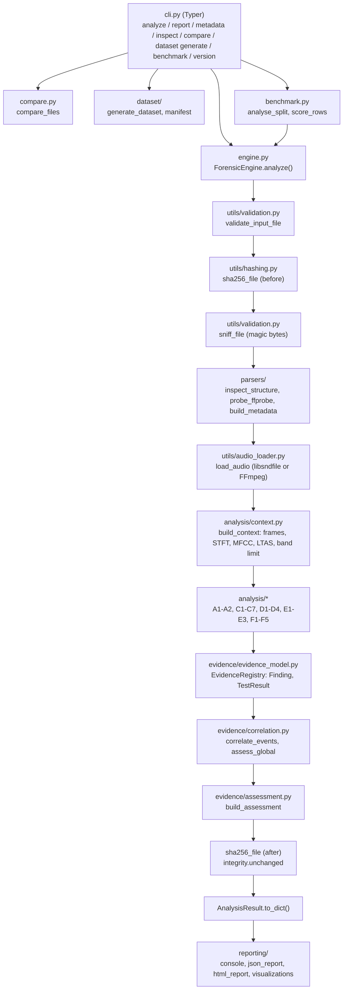

# SonicTrace

**An explainable digital audio forensics and manipulation analysis engine.**

SonicTrace examines an audio file and reports technical traces of editing, splicing,
re-encoding, resampling and other processing. It does **not** label recordings "real" or
"fake". For every investigation it states what was directly observed, which measurements
are only statistically unusual, how independent observations corroborate each other, which
legitimate processes could explain them, and what cannot be concluded.

`Python 3.11+` · `NumPy` · `SciPy` · `soundfile` · `scikit-learn` · `Matplotlib` · `Typer` · `Rich` · optional `FFmpeg` · MIT license · no API keys, no network

---

## Contents

1. [Overview](#1-overview)
2. [Problem statement and motivation](#2-problem-statement-and-motivation)
3. [Objectives](#3-objectives)
4. [Main features](#4-main-features)
5. [Implemented forensic techniques](#5-implemented-forensic-techniques)
6. [Technology stack](#6-technology-stack)
7. [Architecture](#7-architecture)
8. [Folder structure](#8-folder-structure)
9. [Installation (Windows)](#9-installation-windows)
10. [Configuration and API keys](#10-configuration-and-api-keys)
11. [Using the CLI](#11-using-the-cli)
12. [Example output (actual execution)](#12-example-output-actual-execution)
13. [Report structure](#13-report-structure)
14. [Synthetic dataset and benchmark](#14-synthetic-dataset-and-benchmark)
15. [Automated tests](#15-automated-tests)
16. [Limitations and known issues](#16-limitations-and-known-issues)
17. [Security and privacy](#17-security-and-privacy)
18. [Future improvements](#18-future-improvements)
19. [Contributing](#19-contributing)
20. [License](#20-license)
21. [Further documentation](#21-further-documentation)

---

## 1. Overview

SonicTrace is a command-line forensic research prototype. Given a WAV, FLAC, Ogg, AIFF
(natively) or MP3/AAC/M4A (through FFmpeg) file it:

1. hashes the file (SHA-256) and parses its binary container structure itself;
2. decodes the audio read-only and computes shared signal representations (frames, STFT,
   mel spectrum, MFCCs, long-term spectrum, noise floor);
3. runs **21 independent forensic tests** in six modules (A-F);
4. correlates their findings in time and at file level (Module G) using explicit
   independence rules;
5. produces ordinal **indicator levels** (none / weak / moderate / strong) - never a
   probability - plus processing-history statements and a list of what cannot be concluded;
6. writes a console summary, a JSON report and a self-contained HTML report with figures,
   and re-hashes the file to prove it was not modified.

It also ships a deterministic synthetic dataset generator with ground truth and a
benchmark that scores every technique, including against legitimately processed audio.

## 2. Problem statement and motivation

Audio recordings are used as evidence in investigations, journalism and disputes, and
editing them is easy. Detecting edits is hard because:

* a cut in a pause, a crossfaded edit or a re-recording can leave almost no trace;
* routine processing (MP3 distribution, normalisation, noise gates, resampling) produces
  signals that *look* suspicious;
* single-score "tamper detectors" hide their reasoning, so a reviewer cannot tell an
  observation from an inference.

SonicTrace was developed to show the opposite approach: many small, documented tests,
each reporting its measurement, threshold, alternative explanations and limitations, and
a correlation layer that only calls an edit point *corroborated* when methods based on
different physical principles agree.

**Real-world relevance.** The same principles are used in forensic audio authentication
practice (e.g. container analysis, ENF analysis, spectral examination - see
`research/methodology.md` for references). SonicTrace is a research and teaching
prototype; its numbers come from synthetic data and it is not a validated casework tool.

## 3. Objectives

* Identify technical evidence of editing, splicing, re-encoding, resampling, gain changes,
  inserted silence, duplicated segments and metadata/container inconsistencies.
* Keep **observed evidence**, **statistical anomalies**, **possible explanations** and
  **undeterminable questions** strictly separate.
* Make every result reproducible: deterministic analysis, recorded configuration and tool
  versions, synthetic dataset from a seed, versioned methodology.
* Measure performance honestly, including false positives on legitimate processing.

## 4. Main features

| Area | What is implemented |
|---|---|
| File structure | Own binary parsers: RIFF/WAVE/RF64 (incl. `LIST/INFO`, `bext`, `ds64`), MPEG audio frames (ID3, Xing/Info/VBRI, LAME tag), FLAC (STREAMINFO + **PCM-MD5 verification**), Ogg (**page CRC-32**, sequence gaps, chained streams), MP4/M4A boxes, ADTS, AIFF; magic-byte sniffing; FFprobe metadata; software-signature classification |
| Signal analysis | RMS, peak, true peak, crest factor, DC offset, clipping, zero-crossing rate, STFT, spectral centroid/bandwidth/roll-off/flatness/flux, mel spectrum, MFCC, long-term spectrum, band-energy distribution, noise floor |
| Forensic tests | 21 tests (section 5) with per-test score, threshold, summary and findings |
| Evidence model | Finding objects with ID, test, method, family, category, severity, time and sample range, measurements, baseline, alternatives, limitations |
| Correlation | Time clustering with independence rules; processing-history assessments; indicator levels; false-positive considerations; "cannot be concluded" list |
| Comparison | `compare`: block-wise NCC alignment against a reference to locate removed/inserted material, unmatched blocks, gain changes, bandwidth differences |
| Reports | Console (Rich), JSON, self-contained HTML with 11 sections and 6 embedded figures |
| Dataset | Deterministic synthetic dataset (140 files by default), ground-truth labels, transformation logs, source-disjoint calibration/evaluation splits |
| Benchmark | Precision/recall/F1/FPR per technique, correlated decisions, confusion matrix, per-condition rates, localisation, threshold sweeps, FP/FN lists |
| Integrity | Read-only access, SHA-256 before and after analysis, private temp dirs for FFmpeg, resource limits, deterministic results |

## 5. Implemented forensic techniques

Test IDs as they appear in every report.

| ID | Module | Technique | Evidence category of findings |
|---|---|---|---|
| A1 | A file structure | Container structure and binary consistency (chunk sizes, header fields, frame/page integrity, checksums) | observed |
| A2 | A file structure | Declared vs. decoded properties (duration, channels), extension vs. content | observed |
| C1 | C splicing | Waveform discontinuity: isolated impulses in the LPC prediction residual | observed |
| C2 | C splicing | Short-time energy discontinuity (supporting only) | statistical |
| C3 | C splicing | Spectral discontinuity, log-spectral distance (supporting only) | statistical |
| C4 | C splicing | Background noise-floor consistency (minimum statistics) | statistical |
| C5 | C splicing | Digital silence and padding (exact-zero runs, gating-pattern rule) | observed |
| C6 | C splicing | Duplicated segments: log-mel self-similarity + waveform NCC verification | observed |
| C7 | C splicing | ENF (mains hum) phase continuity | observed |
| D1 | D compression | Spectral band limit (steep low-pass below Nyquist) | observed |
| D2 | D compression | Spectral holes (codec quantisation to zero) | observed |
| D3 | D compression | Effective bit depth and sample-value histogram combing (local vs. whole-file gain) | observed |
| D4 | D compression | Codec low-pass/bitrate consistency (LAME tag or measured libmp3lame model) | observed |
| E1 | E resampling | Empty band below Nyquist with candidate original sample rates | observed |
| E2 | E resampling | Interpolation periodicity in the prediction residual (experimental) | statistical |
| E3 | E resampling | Sample-rate metadata consistency | observed |
| F1 | F statistics | Robust z-score / MAD outlier windows | statistical |
| F2 | F statistics | Isolation Forest window anomalies | statistical |
| F3 | F statistics | PELT change-point detection | statistical |
| F4 | F statistics | Adjacent-window Kolmogorov-Smirnov test | statistical |
| F5 | F statistics | Delta-BIC segmentation on MFCCs | statistical |

Module F results are never used as evidence of manipulation; they are context.
Mathematics: [`docs/mathematics.md`](docs/mathematics.md); beginner explanations:
[`docs/INTERNAL_WORKING.md`](docs/INTERNAL_WORKING.md).

## 6. Technology stack

| Technology | Role in SonicTrace | Mandatory |
|---|---|---|
| Python 3.11+ | implementation language (dataclasses, type hints, `pathlib`) | yes |
| NumPy | arrays, FFT (`numpy.fft`), cumulative sums, histograms, statistics | yes |
| SciPy | Welch PSD, Butterworth/`sosfiltfilt`, `resample_poly`, `lfilter`, `solve_toeplitz` (LPC), `ks_2samp`, DCT, `ndimage` filters | yes |
| soundfile (libsndfile) | read-only decoding of WAV/FLAC/Ogg/AIFF; writing dataset WAVs | yes |
| scikit-learn | `IsolationForest` (test F2) | yes |
| Matplotlib (Agg backend) | the six report figures and the comparison figure | yes |
| Typer + Rich | CLI commands, options, tables, progress bars | yes |
| pytest | automated tests | dev only |
| FFmpeg / FFprobe | decoding MP3/AAC/M4A, technical metadata, MP3 dataset conditions | optional |

Not used: librosa (mel/MFCC implemented directly), databases, web frameworks, cloud APIs.

## 7. Architecture



Design decisions: every representation is computed once in an `AnalysisContext` and
shared; each test runs inside an error guard (`_safe`) so a failing test is recorded as
`error` instead of stopping the investigation; all thresholds live in one dataclass
(`config.py`) whose values are written into every report.

## 8. Folder structure

```
SonicTrace/
|-- README.md                    this file
|-- KEYS_AND_SETUP_GUIDE.md      keys/env/dependency audit and setup
|-- PROJECT_COMPLETION_REPORT.md features, tests, results, quality gate
|-- TODO.md                      open work
|-- LICENSE                      MIT
|-- pyproject.toml               package metadata, dependencies, `sonictrace` entry point
|-- requirements.txt             same dependencies for plain pip
|-- src/sonictrace/
|   |-- cli.py                   Typer CLI (8 commands)
|   |-- engine.py                orchestration: ForensicEngine, AnalysisResult
|   |-- compare.py               reference comparison
|   |-- benchmark.py             scoring against ground truth
|   |-- config.py                AnalysisConfig: every threshold and limit
|   |-- errors.py                exception classes -> CLI exit codes
|   |-- data/lame_cbr_cutoffs.json  measured LAME low-pass model (written by a script)
|   |-- parsers/                 Module A: wav_parser, codec_inspector, metadata, common
|   |-- analysis/                Modules B-F: signal_features, spectral_analysis, context, stats,
|   |                            splice_detection, noise_analysis, duplication, enf_analysis,
|   |                            compression_analysis, codec_models, resampling_analysis,
|   |                            anomaly_detection, structure_tests
|   |-- evidence/                Module G: evidence_model, correlation, assessment
|   |-- dataset/                 sources, transformations, generator, manifest
|   |-- reporting/               json_report, html_report, visualizations
|   `-- utils/                   audio_loader, hashing, tools (FFmpeg), validation
|-- tests/                       54 pytest tests (+ conftest.py fixtures)
|-- scripts/                     run_demo.py, verify_lame_lowpass.py, reproduce.ps1, reproduce.sh
|-- docs/                        INTERNAL_WORKING.md, MANUAL_TESTING_GUIDE.md, PROJECT_WORKFLOW.md, mathematics.md
|-- research/                    methodology, experiments, false-positive analysis, limitations,
|                                LAME verification, benchmark tables (v1.0, v1.1, v1.2)
|-- examples/                    demo evidence pair, reports, figures, comparison, benchmark JSON
|-- datasets/                    generated dataset (git-ignored, reproducible)
`-- output/                      run outputs (git-ignored)
```

## 9. Installation (Windows)

Requirements: Windows 10/11, Python 3.11 or newer (tested with 3.12.5), about 350 MB of
disk for the virtual environment and 70 MB for the default dataset. FFmpeg is optional.

```powershell
cd D:\SoniTrace                      # your project folder
py -3.12 -m venv .venv               # or: python -m venv .venv
.\.venv\Scripts\Activate.ps1
python -m pip install --upgrade pip
python -m pip install -e ".[dev]"    # installs SonicTrace + dependencies + pytest
sonictrace version
```

If PowerShell refuses to run `Activate.ps1`, see
[KEYS_AND_SETUP_GUIDE.md](KEYS_AND_SETUP_GUIDE.md#6-windows-powershell-setup-commands)
(either `Set-ExecutionPolicy -Scope CurrentUser -ExecutionPolicy RemoteSigned`, or call
`.\.venv\Scripts\sonictrace.exe` directly).

**FFmpeg (optional)** - needed for MP3/AAC/M4A input, FFprobe metadata and the MP3
dataset conditions:

```powershell
winget install --id Gyan.FFmpeg -e   # or: scoop install ffmpeg / choco install ffmpeg
ffmpeg -version                      # in a new terminal
```

Linux/macOS: `python3 -m venv .venv && source .venv/bin/activate && pip install -e ".[dev]"`;
FFmpeg from the system package manager.

## 10. Configuration and API keys

* **No API keys, tokens, accounts, databases or network services are required.** The
  project does not read any environment variable or `.env` file (see
  [KEYS_AND_SETUP_GUIDE.md](KEYS_AND_SETUP_GUIDE.md)).
* Runtime options: `--max-mib`, `--max-duration` (resource limits), `--no-stats` (skip
  Module F), global `--debug` (tracebacks).
* Thresholds: `src/sonictrace/config.py` (`AnalysisConfig`); every report contains the
  values used.

## 11. Using the CLI

Run `sonictrace --help` or `sonictrace <command> --help` for the built-in help.

| Command | Purpose | Main options |
|---|---|---|
| `sonictrace analyze FILE` | full investigation, console summary | `-f/--format text\|json`, `--json-out PATH`, `--html-out PATH`, `--no-stats`, `--max-mib`, `--max-duration` |
| `sonictrace report FILE` | HTML + JSON + 6 figures | `-o/--out-dir` (default `output\reports`), `--max-mib`, `--max-duration` |
| `sonictrace metadata FILE` | identity, FFprobe metadata, tags, software signatures | `--json` |
| `sonictrace inspect FILE` | binary structure (chunks/frames/blocks/pages/boxes) | `--json` |
| `sonictrace compare ORIGINAL MODIFIED` | reference comparison | `-o/--out-dir`, `--json` |
| `sonictrace dataset generate` | synthetic dataset | `-o/--out`, `--seed`, `--sources`, `--controls`, `--duration`, `--no-mp3` |
| `sonictrace benchmark` | score techniques on a split | `-d/--dataset`, `--split calibration\|evaluation\|all`, `-o/--out` |
| `sonictrace version` | versions of all components | - |

Global option: `sonictrace --debug <command> ...`. `python -m sonictrace ...` works too.

Exit codes: `0` success, `1` unexpected internal error, `2` invalid input (e.g. file not
found, bad option value), `3` unsupported format, `4` malformed or empty file, `5` resource
limit exceeded, `6` required external tool (FFmpeg) missing.

### Analyse an audio file

```powershell
sonictrace analyze examples\demo\manipulated.wav
sonictrace analyze examples\demo\manipulated.wav --format json            # JSON on stdout
sonictrace analyze examples\demo\manipulated.wav --json-out output\r.json --html-out output\r.html
```

### Generate a full forensic report

```powershell
sonictrace report examples\demo\manipulated.wav --out-dir output\reports
```

Writes `output\reports\manipulated_report.html`, `manipulated_report.json` and
`manipulated_report_figures\*.png` (waveform, spectrogram, frequency, RMS, noise floor,
timeline).

### Inspect metadata and binary structure

```powershell
sonictrace metadata examples\demo\original.wav
sonictrace metadata examples\demo\original.wav --json
sonictrace inspect examples\demo\original.wav
sonictrace inspect datasets\sonictrace_v1\audio\eva_src00__mp3_transcoded.mp3 --json
```

### Compare two files

```powershell
sonictrace compare examples\demo\original.wav examples\demo\manipulated.wav --out-dir output\compare
```

### Generate the dataset and run the benchmark

```powershell
sonictrace dataset generate                          # 140 files in datasets\sonictrace_v1 (seed 1337)
sonictrace benchmark --split evaluation --out output\benchmark
```

### Run the end-to-end demo

```powershell
python scripts\run_demo.py
```

## 12. Example output (actual execution)

Demo pair created by `scripts/run_demo.py`: an 8 s speech-like recording with 50 Hz mains
hum, and a copy with three edits (0.352 s cut at 2.30 s, 0.40 s digital silence inserted
at 4.10 s, 0.5 s copied from 1.0 s and pasted at 6.0 s).

`sonictrace analyze examples\demo\original.wav` (excerpt):

```
SHA-256 d20a5c1b35d90e0adb339d98b35fda538ad87a87ff29dbd209d812cc811fd45d
Evidence unchanged after analysis: yes
Local edit indicators: NONE    Structural inconsistencies: NONE
C7 | ENF (mains hum) phase continuity | completed | - | 3.84 | 50 Hz hum present; phase evolves continuously.
```

`sonictrace analyze examples\demo\manipulated.wav` (excerpt):

```
Local edit indicators: STRONG    Structural inconsistencies: NONE
EV-001 | 2.170-2.470 | corroborated | enf, waveform    | Samples removed or inserted here ...
EV-002 | 4.020-4.580 | corroborated | enf, silence     | Insertion of digital silence, or muting/gating ...
EV-003 | 5.870-6.264 | corroborated | duplication, enf | Copy-move edit: material repeated from elsewhere ...
EV-004 | 6.290-6.630 | corroborated | duplication, enf | Copy-move edit ...
Observed technical evidence (medium/high):
  SIL-001  Digital silence of 400 ms at 4.100-4.500 s
  DUP-001  Segment at 6.18-6.37 s duplicates 1.18-1.37 s
  ENF-001  Mains-hum phase jumps by 2.13 rad near 2.32 s
  ENF-002  Mains-hum phase jumps by 6.15 rad near 4.30 s
  ...
Cannot be concluded:
  - Whether the recording is authentic, or whether it truthfully represents the events it appears to capture.
  - Whether the voice or content is synthetic/AI-generated: no test in this engine addresses speech synthesis.
  ...
```

`sonictrace compare examples\demo\original.wav examples\demo\manipulated.wav`:

```
identical bytes: False; matched blocks: 84 %; global offset: 0.0 s
About 0.352 s of material was removed from the questioned file between 2.00 s and 2.75 s (alignment offset step).
About 0.400 s of material was inserted into the questioned file between 3.75 s and 4.75 s (alignment offset step).
Block at 4.25 s has no counterpart in the reference within +/-2 s (NCC 0.13).
Block at 6.25 s has no counterpart in the reference within +/-2 s (NCC 0.48).
```

The pasted segment's source lies 5 s away, outside compare's +/-2 s search window, so it
appears as "no counterpart" rather than "copied from 1.0 s".

## 13. Report structure

**JSON** (`analyze --format json`, `--json-out`, `report`) - top-level keys:

| Key | Content |
|---|---|
| `report_type`, `schema_version`, `generated_utc`, `tool` | identification, SonicTrace and methodology version |
| `file_identity` | name, path, size, SHA-256, container, analysis time |
| `integrity` | `sha256_before`, `sha256_after`, `unchanged`, `access_mode` |
| `metadata` | identity, FFprobe technical data, tags, software signatures |
| `structure` | binary-parser details and structural issues |
| `audio` | sample rate, channels, frames, duration, subtype, decoder |
| `signal_summary`, `frequency_distribution` | levels, true peak, clipping, spectral medians, band limit, noise floor |
| `assessment` | indicator levels, summary, rationale, observed evidence, statistical anomalies, possible explanations, cannot-be-concluded, not-applicable tests, false-positive considerations |
| `global_assessments` | lossy coding, transcoding, upsampling, gain change, container integrity |
| `correlated_events` | time-localised events with strength and independent families |
| `tests` | all 21 test results (status, score, threshold, summary, finding IDs) |
| `findings` | every finding with all evidence fields |
| `environment`, `config`, `timing` | versions, all thresholds used, run time |

**HTML** (`report`, `--html-out`): 1 Investigation summary, 2 File identity and SHA-256,
3 File metadata, 4 Audio characteristics (with waveform, spectrogram, frequency, RMS and
noise-floor figures), 5 Individual forensic tests, 6 Detected anomalies (observed vs.
statistical), 7 Suspicious timestamps (with timeline figure), 8 Evidence correlation,
9 False-positive considerations, 10 Methodology limitations, 11 Final evidence-based
assessment, plus an appendix with environment and configuration. Example:
[`examples/demo/reports/manipulated_report.html`](examples/demo/reports/manipulated_report.html).

## 14. Synthetic dataset and benchmark

`sonictrace dataset generate` synthesises speech-like (formant) and music-like (harmonic)
sources in four environments (room, 50 Hz mains hum with drift, street, quiet), quantised
to 16-bit with TPDF dither, and derives 17-18 conditions per source (clean, added noise,
hard cut, crossfaded cut, inserted silence, gain step, copy-overwrite, background splice,
three resampling variants, three MP3 chains, normalisation, noise gate, loop) plus
unmodified controls. Defaults: seed 1337, 4 sources + 4 controls per split, 6 s per file
-> **140 files** (70 calibration + 70 evaluation), about 11 s. `manifest.json` /
`manifest.csv` contain labels, edit times, transformation logs and SHA-256. The same seed
produces bit-identical files.

`sonictrace benchmark` scores each technique on a split. Held-out evaluation results
(methodology 1.2, **synthetic data only - not real-world accuracy**):

| Decision | Precision | Recall | False-positive rate |
|---|---|---|---|
| Local edit level >= moderate | 0.733 | 0.458 | 0.087 |
| Lossy coding indicated/established | 1.000 | 0.833 | 0.000 |
| D2 spectral holes | 1.000 | 0.833 | 0.000 |
| D3 local gain edit | 1.000 | 0.500 | 0.000 |
| D4 transcoded MP3 (see note) | 1.000 | 0.500 | 0.000 |
| E1 empty band alone / upsampling indicated (correlated) | 0.167 / 0.500 | 0.167 / 0.167 | 0.172 / 0.034 |
| C2 energy jumps alone (supporting only) | 0.343 | 1.000 | 1.000 |

Note on D4: the gap fixed in methodology 1.2 was noticed while running an
evaluation-split file. The fix rests on a separate measurement on noise and was not tuned
on dataset files, but the D4 evaluation numbers are not fully blind
([`research/experiments.md`](research/experiments.md), E4).

Full tables: [`research/benchmark_v1.2_evaluation.md`](research/benchmark_v1.2_evaluation.md);
interpretation: [`research/experiments.md`](research/experiments.md);
false-positive study: [`research/false_positive_analysis.md`](research/false_positive_analysis.md).

## 15. Automated tests

```powershell
python -m pytest
```

Result (verified): **54 tests - 53 passed, 1 xfailed** with FFmpeg; 49 passed, 4 skipped,
1 xfailed without FFmpeg. The xfail test documents a known limitation (44.1 -> 48 kHz
upsampling is not detected). Test files: `test_parsers` (WAV/MP3/FLAC/Ogg parsing incl.
malformed, truncated, concatenated and tampered files), `test_analysis` (signal
descriptors), `test_splicing`, `test_resampling`, `test_compression` (D4 on real
libmp3lame encodes), `test_evidence` (correlation rules), `test_dataset` (determinism, no
split leakage), `test_reporting` (JSON/HTML/figures, determinism), `test_cli` (every
command, malformed/unsupported/missing/over-limit input), `test_regression_fp`
(false-positive regressions, evidence immutability).

## 16. Limitations and known issues

* Benchmark numbers come from a **small synthetic dataset**; they are not forensic error rates.
* Crossfaded edits (0/8 found) and cuts inside pauses are largely invisible to the tests.
* Downsampling leaves no trace; 44.1 -> 48 kHz upsampling is not detected (xfail test).
* The number of lossy generations is not established; D4 only covers CBR MPEG-1 Layer III
  from LAME/FFmpeg at 44.1/48 kHz when the tag records no low-pass.
* Noise gates and loop-based music produce genuine digital-silence and duplication
  observations that need context to interpret.
* Duplicate detection (C6) can match strongly periodic backgrounds: on one evaluation
  file two pauses dominated by mains hum matched with NCC 0.9802, just above the 0.98
  threshold (FP-6 in [`research/false_positive_analysis.md`](research/false_positive_analysis.md)).
* Module F statistics flag most unedited files (by design they are context only).
* No synthetic/AI speech detection; no stereo-specific splice tests.

Details: [`research/limitations.md`](research/limitations.md), open work: [`TODO.md`](TODO.md).

## 17. Security and privacy

* Evidence files are opened **read-only** and hashed before and after analysis; the report
  states whether the file changed (`integrity.unchanged`).
* No network access, no telemetry, no external services; audio never leaves the machine.
* FFmpeg/FFprobe are run as argument lists (no shell), with timeouts, writing only into a
  private temporary directory that is deleted afterwards.
* Resource limits (512 MiB, 600 s, 16 channels by default) prevent memory exhaustion by
  oversized inputs.
* Reports contain file paths, hashes and filesystem timestamps - handle reports of real
  evidence as sensitive material.

## 18. Future improvements

MDCT-domain double-compression analysis, a stopband-shape resampling model, crossfade
signatures, stereo/inter-channel tests, D4 models for VBR and other encoders, a
real-recording validation set and bootstrap confidence intervals (see `TODO.md`).

## 19. Contributing

1. Create a virtual environment and `pip install -e ".[dev]"`; make sure `python -m pytest` passes.
2. Keep one responsibility per test: a new detector returns a `TestResult` and adds
   `Finding`s through the `EvidenceRegistry`, with measurements, baseline, alternative
   explanations and limitations.
3. Put thresholds in `AnalysisConfig`; bump `METHODOLOGY_VERSION` in
   `src/sonictrace/__init__.py` whenever detection rules or thresholds change, and re-run
   the benchmark on both splits.
4. Add a unit test and, for every false positive you fix, a regression test in
   `tests/test_regression_fp.py`.
5. Never add network calls, secrets or code that writes to the evidence file.
6. Report benchmark changes honestly, including regressions, in `research/experiments.md`.

## 20. License

MIT - see [LICENSE](LICENSE).

## 21. Further documentation

| Document | Content |
|---|---|
| [KEYS_AND_SETUP_GUIDE.md](KEYS_AND_SETUP_GUIDE.md) | API-key/environment audit, setup, optional dependencies |
| [docs/INTERNAL_WORKING.md](docs/INTERNAL_WORKING.md) | beginner-to-advanced explanation of every module and algorithm, interview preparation |
| [docs/MANUAL_TESTING_GUIDE.md](docs/MANUAL_TESTING_GUIDE.md) | step-by-step manual test cases and end-to-end demonstration |
| [docs/PROJECT_WORKFLOW.md](docs/PROJECT_WORKFLOW.md) | workflows, diagrams, command reference, troubleshooting, quick reference |
| [docs/mathematics.md](docs/mathematics.md) | equations, assumptions, failure modes |
| [research/methodology.md](research/methodology.md) | research design, references |
| [PROJECT_COMPLETION_REPORT.md](PROJECT_COMPLETION_REPORT.md) | features, tests, results, quality gate |
