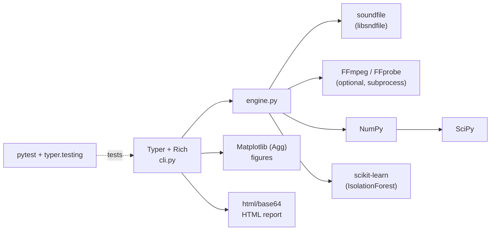
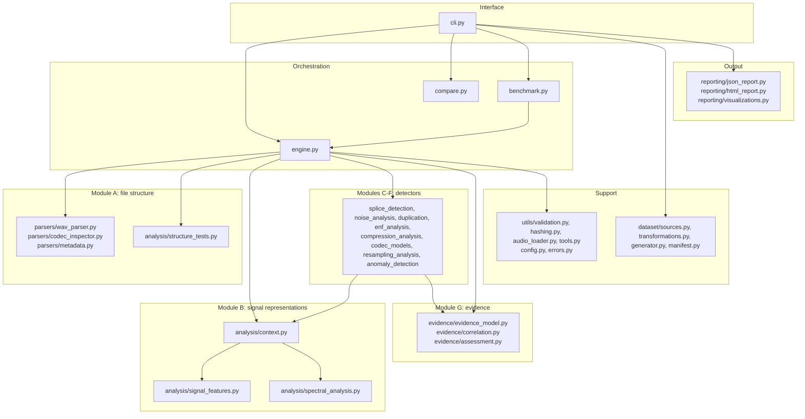
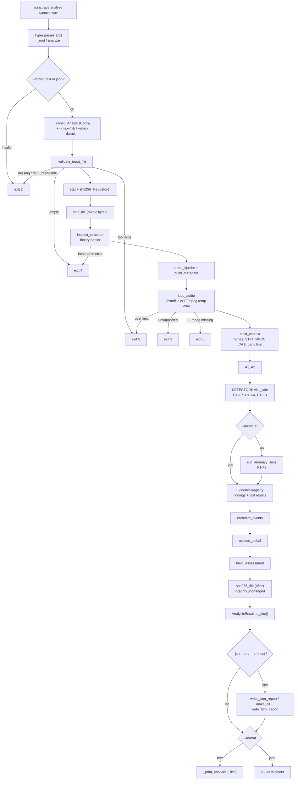
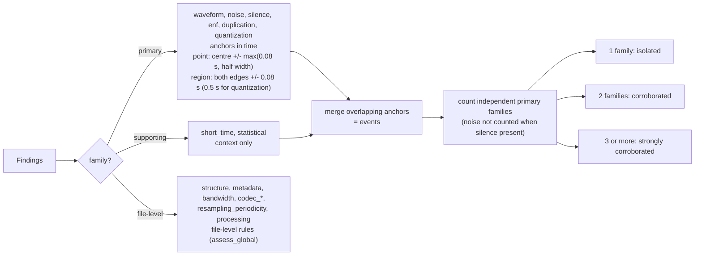

# SonicTrace - How It Works Inside

A complete explanation of the implemented software, from first principles to the exact
functions in the code. Everything here describes SonicTrace 0.1.0, methodology 1.2, as
it exists in `src/sonictrace/`. Numbers in examples come from real runs on the files in
`examples/demo/` and the synthetic dataset (`sonictrace dataset generate`, seed 1337).

How to read it: Section A explains the concepts, B the libraries, C the code layout,
D every algorithm, E what happens when you run `sonictrace analyze`, F how decisions are
made, G where this is useful, and H prepares you for interviews.

---

## Contents

* [Section A - Project fundamentals](#section-a---project-fundamentals)
* [Section B - Technology stack](#section-b---technology-stack)
* [Section C - Internal architecture](#section-c---internal-architecture)
* [Section D - Forensic algorithms](#section-d---forensic-algorithms)
* [Section E - Complete execution flow of `sonictrace analyze`](#section-e---complete-execution-flow-of-sonictrace-analyze)
* [Section F - Evidence and decision making](#section-f---evidence-and-decision-making)
* [Section G - Real-world applications](#section-g---real-world-applications)
* [Section H - Technical interview preparation](#section-h---technical-interview-preparation)

---

# Section A - Project fundamentals

### A.1 What is digital audio forensics?

Digital audio forensics is the scientific examination of audio recordings to answer
questions such as *Is this recording continuous? Was anything removed or inserted? Has it
been converted, compressed or processed? Does the file's internal structure agree with
what it claims to be?* An examiner looks at two kinds of evidence:

* the **container** - the bytes of the file: headers, chunk sizes, encoder tags,
  checksums, timestamps;
* the **signal** - the sound itself: its waveform, spectrum, background noise, hum.

Analogy: examining a paper document. You inspect the paper and binding (container) as
well as the writing (signal). A page glued in from another document may show a different
paper texture (background noise), an inconsistent edge (waveform discontinuity) or a page
number that no longer matches (header field).

### A.2 What problem does SonicTrace solve?

It automates a set of well-understood forensic examinations, runs them independently,
and reports - for each one - what was measured, against which threshold, what the result
could mean (including innocent explanations) and what it cannot mean. Then it combines
the results with explicit rules: an edit point is "corroborated" only when tests that
work on different physical principles agree. It never outputs "real/fake" or a
probability.

### A.3 Why is audio manipulation difficult to detect?

* **Edits can be invisible.** Cutting inside a pause removes background noise next to
  background noise; a 10 ms crossfade hides the join. In the benchmark, none of the 8
  crossfaded cuts was detected.
* **Innocent processing looks suspicious.** MP3 compression, normalisation, noise gates
  and resampling are routine, yet they leave the same fingerprints that editing tools do.
* **Natural sound is irregular.** Speech has pauses, onsets and plosives; music has
  repeated loops. A detector that flags "unusual" moments flags normal content.
* **Re-recording and re-encoding destroy fine evidence** (sample-level discontinuities,
  hum phase, codec traces).

### A.4 What is an audio container?

The file format that *wraps* audio data and metadata. A WAV file is a RIFF container:
a 12-byte header (`RIFF`, size, `WAVE`) followed by *chunks* - each a 4-letter ID, a size
and a payload (`fmt ` = format description, `data` = samples, `LIST` = text tags...). MP3
files are a sequence of frames (each with a 4-byte header) plus optional ID3 tags. FLAC,
Ogg and MP4 have their own structures. Analogy: the container is the envelope and the
table of contents; the audio is the letter.

Why it matters: the container records claims (sample rate, length, encoder, checksums)
that can be checked against the actual content. SonicTrace parses these bytes itself
(`parsers/wav_parser.py`, `parsers/codec_inspector.py`).

### A.5 What is a codec?

A **co**der/**dec**oder - the algorithm that represents samples in a stream. PCM
(uncompressed integers) is the simplest. MP3, AAC, Vorbis and Opus are *lossy perceptual
codecs*: they discard sound that a psychoacoustic model predicts you will not hear -
especially high frequencies and quiet components masked by loud ones. FLAC is lossless.
Lossy codecs leave fingerprints: a sharp high-frequency cut-off and "holes" in the
spectrum.

### A.6 What is a waveform?

The sequence of sample values over time - air pressure measured thousands of times per
second. Plotted, it is the familiar wiggly line. A splice can appear as a sudden jump in
that line. Figure: `*_waveform.png` in every report.

### A.7 What is a spectrogram?

A picture of how the frequency content changes over time: time on the x-axis, frequency
on the y-axis, colour = energy. It is built by cutting the signal into short overlapping
frames and taking the Fourier transform of each (the STFT). A codec's low-pass shows as a
horizontal line above which everything is dark; inserted silence shows as a vertical dark
band. Figure: `*_spectrogram.png`.

### A.8 What is frequency-domain analysis?

Any signal can be written as a sum of sine waves of different frequencies. The **Fourier
transform** computes how much of each frequency is present. Analysing that spectrum
(instead of the waveform) reveals things invisible in the time domain: band limits,
spectral holes, mains hum at 50 Hz, the formants of speech. SonicTrace uses `numpy.fft`
(FFT = fast algorithm for the discrete Fourier transform).

### A.9 What is a sampling rate?

How many samples per second are stored (44 100 Hz for CD audio, 48 000 Hz for video).
By the **Nyquist theorem**, a rate `fs` can represent frequencies only up to `fs/2`
(the Nyquist frequency: 22 050 Hz at 44.1 kHz). If audio recorded at 16 kHz is later
*upsampled* to 44.1 kHz, the file claims 22 kHz of bandwidth but nothing exists above
8 kHz - an empty band that SonicTrace measures (test E1).

### A.10 What is quantization?

Storing each sample as an integer with a fixed number of bits. 16-bit audio has 65 536
possible values; one step is 1 LSB (least significant bit). Rounding to those steps adds
tiny quantization noise; *dither* (a little random noise added before rounding) keeps the
error random. Forensic relevance: if 16-bit integers are multiplied by a gain and rounded
again, some integer values can no longer occur - the sample-value histogram gets regular
gaps (a "comb"), which test D3 detects.

### A.11 What is an audio splice?

Joining two pieces of audio - removing a segment (cut), inserting material (silence,
another recording, a copy of another part) or overwriting a section. Typical traces: an
abrupt waveform step, a sudden change in background noise, a broken mains-hum phase,
exact digital zeros, or a segment that is a sample-exact copy of another.

### A.12 What is a noise floor?

The quiet background present in every acoustic recording: room tone, microphone and
pre-amplifier noise, traffic, ventilation. It is what you hear in the pauses. Within one
continuous take it changes slowly; material recorded elsewhere usually has a different
level and colour of noise, and inserted digital silence has *no* noise at all. SonicTrace
estimates it with "minimum statistics" (the quietest 10 % of frames).

### A.13 Small glossary

| Term | Meaning |
|---|---|
| dBFS | decibels relative to digital full scale (0 dBFS = the largest possible sample; -60 dBFS is 1000x smaller in amplitude) |
| frame / hop | a short block of samples analysed together (2048 samples = 46 ms at 44.1 kHz) / the step between frames (512 samples) |
| window | a taper (Hann) applied to a frame before the FFT to reduce spectral leakage |
| LPC | linear predictive coding: predicting each sample from the previous ones |
| robust z-score | `(x - median) / (1.4826 * MAD)`: how unusual a value is, insensitive to outliers |
| NCC | normalised cross-correlation: 1.0 means two waveforms are identical up to scale |
| ENF | electric network frequency: the 50/60 Hz mains hum picked up by recorders |

---

# Section B - Technology stack

For each technology: what it is, why it was selected, the problem it solves, where it is
used, how it interacts with others, and whether it is mandatory.

### B.1 Python 3.11+ (mandatory)

* **What:** the implementation language (tested on 3.12.5).
* **Why:** the scientific ecosystem (NumPy/SciPy/scikit-learn), fast prototyping,
  readable code for a teaching/research tool.
* **Used for:** everything. Features relied on: `dataclasses` (all result objects),
  type hints with `from __future__ import annotations`, `pathlib`, `enum` (categories,
  severities), `functools.lru_cache` (tool discovery, LAME model), `importlib.resources`
  (loading `data/lame_cbr_cutoffs.json`).
* **Standard-library modules used:** `struct` (binary parsing), `hashlib` (SHA-256, MD5
  for FLAC), `json`, `csv`, `tempfile` (private FFmpeg output dir), `subprocess` +
  `shutil.which` (FFmpeg), `html` + `base64` (HTML report), `datetime`, `platform`,
  `traceback`, `collections`, `re`, `math`.

### B.2 NumPy (mandatory)

* **What:** N-dimensional arrays and vectorised math.
* **Why:** audio is a long array of numbers; per-sample Python loops would be ~100x slower.
* **Solves:** fast framing (`sliding_window_view`), FFTs (`numpy.fft.rfft`), cumulative
  sums for RMS and ZCR, histograms (`bincount`), bitwise operations for bit-depth analysis,
  linear algebra for self-similarity matrices (`z.T @ z`).
* **Where:** every analysis module, the dataset synthesiser, the benchmark.
* **Interacts:** all other numeric libraries take and return NumPy arrays; `soundfile`
  returns NumPy arrays; `_clean()` in `evidence_model.py` converts NumPy values to plain
  Python types for JSON.

### B.3 SciPy (mandatory)

* **What:** scientific algorithms built on NumPy.
* **Why:** well-tested implementations of standard signal-processing building blocks.
* **Used (exact functions):** `scipy.signal.welch` (long-term spectrum; ENF PSD; E2),
  `get_window` (Hann), `resample_poly` (true peak, ENF downsampling, compare, dataset
  resampling), `butter` + `sosfiltfilt` / `sosfilt` (ENF band-pass, dataset filters),
  `lfilter` (LPC residual, formant resonators), `correlate` (NCC in C6 and compare);
  `scipy.linalg.solve_toeplitz` (LPC coefficients); `scipy.fft.dct` (MFCC);
  `scipy.ndimage.maximum_filter1d`, `uniform_filter1d`, `median_filter`,
  `gaussian_filter1d` (local maxima, smoothing, histogram expectation);
  `scipy.stats.ks_2samp` (F4).
* **Where:** `analysis/*`, `compare.py`, `dataset/*`.

### B.4 soundfile / libsndfile (mandatory)

* **What:** Python bindings (`cffi`) to libsndfile, a C library for reading/writing audio
  formats. The pip wheel ships libsndfile (version 1.2.2 here).
* **Why:** reliable, lossless decoding of WAV/FLAC/Ogg/AIFF with exact integer values and
  the PCM subtype (needed by D3), without needing FFmpeg.
* **Where:** `utils/audio_loader.py` (`sf.info`, `sf.read` read-only), FLAC MD5
  verification (`sf.SoundFile.blocks` in `codec_inspector.py`), dataset writing, tests.
* **Interacts:** returns float64 arrays to NumPy; FFmpeg output (temporary WAV) is also
  read back through soundfile.

### B.5 FFmpeg / FFprobe (optional, external program)

* **What:** the standard command-line multimedia toolkit.
* **Why:** decoding formats libsndfile does not handle (MP3, AAC, M4A) and providing a
  second, independent metadata view (FFprobe JSON).
* **Where:** `utils/tools.py` (`find_tool`, `tool_version`, `run_tool`) is the only place
  that starts processes; called from `utils/audio_loader.py` (`_load_ffmpeg`),
  `parsers/metadata.py` (`probe_ffprobe`), `dataset/transformations.py` (`mp3_chain` uses
  libmp3lame), `scripts/verify_lame_lowpass.py`.
* **Safety:** argument lists (no shell), timeouts, output only into a
  `tempfile.TemporaryDirectory`. Missing FFmpeg -> `DependencyUnavailableError` (exit 6)
  only when it is actually needed.

### B.6 scikit-learn (mandatory)

* **What:** machine-learning library.
* **Why:** a maintained, deterministic (with `random_state`) Isolation Forest.
* **Where:** only `analysis/anomaly_detection.py` (`IsolationForest`, test F2), imported
  inside the function so the rest of the engine does not depend on it at import time.
* **Note:** SonicTrace does **not** train a manipulation classifier. The Isolation Forest
  is fitted on the windows of the file being analysed and only describes unusual windows.

### B.7 Matplotlib (mandatory)

* **What:** plotting library, used with the non-interactive `Agg` backend (no window).
* **Why:** standard, scriptable figure generation that works headless.
* **Where:** `reporting/visualizations.py` - `plot_waveform`, `plot_spectrogram`,
  `plot_ltas`, `plot_rms`, `plot_noise_floor`, `plot_timeline` (via `make_all`) and
  `plot_comparison`. PNGs are embedded in the HTML as base64 by `html_report.py`.

### B.8 Typer (mandatory)

* **What:** a library that turns type-annotated Python functions into a CLI (parsing,
  help pages, type conversion).
* **Why:** concise command definitions with automatic `--help`; `typer.testing.CliRunner`
  lets tests invoke commands in-process.
* **Where:** `cli.py` (`app`, `dataset_app` sub-group, commands, `_root` callback with the
  global `--debug`), `tests/test_cli.py`.
* **Note:** Typer 0.28 does not install Click; Click is not used directly.

### B.9 Rich (mandatory)

* **What:** terminal formatting (tables, panels, spinners, progress bars).
* **Where:** `cli.py` - `Console`, `Panel`, `Table`, `Progress`. It degrades to ASCII
  when output is redirected to a file.

### B.10 pytest (optional, development)

* **What:** test framework. `pip install -e ".[dev]"` installs it.
* **Where:** `tests/` (54 tests), configuration in `pyproject.toml`
  (`[tool.pytest.ini_options]`), fixtures in `tests/conftest.py`, FFmpeg-dependent tests
  marked with `needs_ffmpeg` (skipped when FFmpeg is absent).

### B.11 What is deliberately *not* used

* **librosa** - not a dependency. Mel filterbank, MFCC, STFT and spectral features are
  implemented in `analysis/spectral_analysis.py` with NumPy/SciPy, which keeps the
  dependency tree small (librosa pulls in numba/llvmlite) and makes every formula
  inspectable.
* No database, web server, cloud API, GPU or deep-learning framework.

### B.12 How they fit together



---

# Section C - Internal architecture

### C.1 Layers



### C.2 Top-level package files

| File | Responsibility | Inputs -> outputs | Key items | Used by |
|---|---|---|---|---|
| `__init__.py` | version identifiers | - | `__version__ = "0.1.0"`, `METHODOLOGY_VERSION = "1.2"` | engine, tools, benchmark, cli |
| `__main__.py` | enables `python -m sonictrace` | argv -> CLI | calls `cli.main()` | Python |
| `cli.py` | command-line interface, error-to-exit-code mapping, console rendering | argv -> console/JSON/files | `app`, `dataset_app`, `_guard`, `_config`, `_print_analysis`, `_write_html`, commands `analyze`, `report`, `metadata`, `inspect`, `compare`, `dataset_generate`, `benchmark`, `version`, `main` | entry point `sonictrace` (pyproject `[project.scripts]`) |
| `engine.py` | orchestrates one investigation | path + `AnalysisConfig` -> `AnalysisResult` | `ForensicEngine.analyze`, `AnalysisResult.to_dict`, `DETECTORS` list, `_safe` error guard | cli, benchmark, tests |
| `config.py` | all thresholds and limits | - -> `AnalysisConfig` | `to_dict`, `from_dict` | everything that analyses |
| `errors.py` | exception hierarchy with exit codes | - | `SonicTraceError` (2), `InputValidationError` (2), `UnsupportedFormatError` (3), `MalformedFileError` (4), `ResourceLimitError` (5), `DependencyUnavailableError` (6) | all modules; cli maps them |
| `compare.py` | reference comparison | two paths -> comparison dict + arrays | `compare_files`, `_best_match` | cli `compare` |
| `benchmark.py` | scoring against ground truth | dataset dir + split -> metrics, md/json/csv | `analyse_split`, `score_rows`, `write_benchmark`, `metrics`, `truth`, `TECHNIQUE_LABEL` | cli `benchmark`, tests |
| `data/lame_cbr_cutoffs.json` | measured LAME low-pass model | written by `scripts/verify_lame_lowpass.py` | 56 entries (sample rate, channels, bitrate, cutoff, steep) | `analysis/codec_models.py` |

### C.3 `utils/` - support code

| Module | Responsibility | Key functions/classes | Inputs -> outputs | Called by |
|---|---|---|---|---|
| `validation.py` | input checks and content-based format detection | `validate_input_file(path, max_bytes)`, `sniff_file(path)`, `sniff_container(head)`, `syncsafe`, `EXTENSION_CONTAINERS`, `CONTAINER_NAMES` | path -> resolved `Path` or exception; bytes -> container name (`wav`, `flac`, `ogg`, `mp4`, `aiff`, `aac_adts`, `mp3`, `unknown`) | engine, compare, cli (metadata/inspect), parsers |
| `hashing.py` | evidence hashing | `sha256_file` (1 MiB chunks), `sha256_bytes` | path -> hex digest | engine, compare, cli, dataset generator |
| `audio_loader.py` | read-only decoding with limits | `LoadedAudio` (samples, sample_rate, subtype, bit_depth, is_integer_pcm, decoded_via, lossy_decoded, warnings; `mono`, `duration`, `describe()`), `load_audio(path, container, max_duration, max_channels)`, `_load_native`, `_load_ffmpeg`, `_check_limits`, `_finalise` | path -> float64 `(frames, channels)` array + facts | engine, compare |
| `tools.py` | the only place that runs external programs | `find_tool` (cached `shutil.which`), `tool_version`, `run_tool(args, timeout)`, `environment_report()` | tool name -> path/version/CompletedProcess | audio_loader, metadata, dataset, engine, cli `version` |

`load_audio` decides the decoder from the *sniffed* container: `wav/flac/ogg/aiff` ->
libsndfile (with FFmpeg as fallback for non-WAV files libsndfile cannot open);
`mp3/mp4/aac_adts` -> FFmpeg into `decoded.wav` (32-bit float) in a temporary directory;
anything else -> `UnsupportedFormatError`. Non-finite samples are replaced by 0 and
reported as a warning (which test A2 turns into a finding).

### C.4 `parsers/` - Module A (file structure)

| Module | Responsibility | Key functions/classes | Output |
|---|---|---|---|
| `common.py` | shared result types | `StructuralIssue(code, severity, message, details)`, `StructureReport(container, parser, details, issues, signatures, tags)` | - |
| `wav_parser.py` | RIFF/WAVE/RF64 chunk walker | `parse_wav`, `_parse_fmt`, `_validate_fmt`, `_parse_info`, `_parse_bext`, `_post_checks`; `WavStructure`, `WavFormat`, `ChunkInfo`; `FORMAT_TAGS`, `INFO_FIELDS` | `WavStructure` with chunks, fmt, data offsets, INFO, bext, issues |
| `codec_inspector.py` | other formats + dispatcher | `inspect_structure(path, container)` (dispatch), `inspect_mp3` (+ `parse_mpeg_header`, `_find_sync`, `_valid_chain`, `_parse_id3v2`, `_parse_vbr_tag`), `inspect_flac` (+ `_flac_pcm_md5`), `inspect_ogg` (+ `ogg_crc`, `_crc_table`), `inspect_mp4` (+ `_mp4_time`), `inspect_adts`, `inspect_aiff`, `_wav_report` | `StructureReport` |
| `metadata.py` | FFprobe metadata and software signatures | `probe_ffprobe(path)`, `build_metadata(path, container, structure, ffprobe)`, `classify_signatures`, `SOFTWARE_PATTERNS` | metadata dict: `identity`, `ffprobe`, `technical`, `tags`, `software_signatures` |

Data flow: engine -> `inspect_structure` (fatal problems raise `MalformedFileError`,
non-fatal ones become `StructuralIssue`s) -> `probe_ffprobe` -> `build_metadata` ->
stored in the `AnalysisContext` and turned into findings by `analysis/structure_tests.py`.

### C.5 `analysis/` - Modules B-F

| Module | Responsibility | Key functions/classes | Reads from context | Writes |
|---|---|---|---|---|
| `context.py` | build every shared representation once | `AnalysisContext` (path, audio, x = mono signal, sr, n_fft, hop, frames, spec, spectral, ltas_freqs, ltas_psd, bandlimit, config, structure, metadata, cache; `duration`, `lsb`), `choose_fft_size`, `build_context` | - | the context |
| `signal_features.py` | time-domain features | `frame_view`, `compute_frame_features` -> `FrameFeatures` (times, rms, rms_db, peak, zcr), `runs_of_true`, `true_peak`, `summarize_signal`, `to_db` | samples | frame features, summary dict |
| `spectral_analysis.py` | frequency-domain features | `compute_stft` -> `Spectrogram`, `mel_filterbank`, `hz_to_mel`, `mel_to_hz`, `compute_spectral_features` -> `SpectralFeatures` (centroid, bandwidth, rolloff, flatness, flux, log_mel, mfcc), `compute_ltas`, `band_energy_distribution`, `detect_bandlimit` -> `BandLimit`, `candidate_source_rates`, `STANDARD_RATES` | signal | representations |
| `stats.py` | robust statistics helpers | `mad`, `robust_z`, `local_maxima`, `group_indices` | arrays | arrays/indices |
| `structure_tests.py` | tests A1, A2 | `run_container_structure`, `run_declared_vs_actual`, `ALTERNATIVES` | structure, metadata, audio | findings `STR-`, `MET-` |
| `splice_detection.py` | tests C1, C2, C3, C5 | `lpc_residual`, `_side_max`, `run_waveform_discontinuity`, `short_time_level`, `run_energy_discontinuity`, `run_spectral_discontinuity`, `run_digital_silence` | x, spec, frames | findings `SPL-`, `SIL-`; caches `lpc_residual` |
| `noise_analysis.py` | test C4 | `NoiseProfile`, `estimate_noise_profile`, `run_noise_consistency` | frames, log-mel | findings `NOI-`; caches `noise_profile` |
| `duplication.py` | test C6 | `run_duplication`, `_ncc_best` | log-mel, frames, x | findings `DUP-` |
| `enf_analysis.py` | test C7 | `detect_enf`, `run_enf_phase` | x | findings `ENF-` |
| `compression_analysis.py` | tests D1-D4 | `run_spectral_cutoff`, `spectral_hole_stats`, `run_spectral_holes`, `integer_codes`, `histogram_comb_blocks`, `run_quantization`, `run_codec_consistency` | bandlimit, spec, audio, structure, metadata | findings `CMP-`, `QNT-`, `MET-` |
| `codec_models.py` | measured LAME low-pass model for D4 | `expected_lame_cutoff`, `_model`, `LAME_LIKE_ENCODERS`, `MODEL_SOURCE` | JSON data file | expected cutoff or `None` |
| `resampling_analysis.py` | tests E1-E3 | `run_nyquist_gap`, `residual_periodicity`, `run_interpolation_periodicity`, `run_rate_consistency` | bandlimit, cached residual, structure | findings `RES-` |
| `anomaly_detection.py` | tests F1-F5 | `window_features`, `run_robust_outliers`, `run_isolation_forest`, `pelt`, `run_change_points`, `run_ks_windows`, `run_delta_bic`, `run_anomaly_suite` | frames, spectral | findings `ANO-` |

Every `run_*` detector has the same contract: `fn(ctx, reg) -> TestResult` (structure
tests take the parsed structure instead of a context). It reads from the context, adds
`Finding`s with `reg.add_finding(prefix, ...)`, and returns one `TestResult` whose
`finding_ids` list links the two. The engine runs them in the order of the `DETECTORS`
list in `engine.py`.

### C.6 `evidence/` - Module G

| Module | Responsibility | Key items |
|---|---|---|
| `evidence_model.py` | data model and ID assignment | `Category` (observed, statistical, explanation, undetermined), `Severity` (info, low, medium, high), `SEVERITY_RANK`, `Localization` (point, region, global), `Finding`, `TestResult`, `EvidenceRegistry` (`add_finding`, `add_test`, `by_test`, `get`), `_clean` (JSON conversion) |
| `correlation.py` | time-based event building and file-level assessments | `correlate_events(findings, tolerance)` -> `CorrelatedEvent` list; `assess_global(findings, tests, container, lossy_decoded)` -> `GlobalAssessment` list; constants `LOCAL_FAMILIES`, `SUPPORTING_FAMILIES`, `PRIMARY_FAMILIES`, `IMPLIED_BY`, `REGION_TOLERANCE`; helpers `_anchors`, `_explain` |
| `assessment.py` | final indicator levels and statements | `build_assessment(...)` -> `Assessment`; `_level_local`, `_level_structure`, `CANNOT_CONCLUDE`, `LEVELS` |

### C.7 `reporting/`

| Module | Responsibility | Key functions |
|---|---|---|
| `json_report.py` | write the report dict as UTF-8 JSON | `write_json_report(report, path)` |
| `html_report.py` | self-contained HTML (inline CSS, base64 images, HTML-escaped text) | `render_html(report, figures)`, `write_html_report`, helpers `_finding_html`, `_kv_table`, `_badge`, `_img`, `_e` |
| `visualizations.py` | PNG figures | `make_all(ctx, report, out_dir, stem)` -> `{waveform, spectrogram, frequency, rms, noise_floor, timeline}`; `plot_comparison` |

### C.8 `dataset/`

| Module | Responsibility | Key functions |
|---|---|---|
| `sources.py` | synthetic recordings and environments | `synth_speech` (formant synthesis with jitter, intonation, fricatives, pauses), `synth_tonal` (harmonic notes, vibrato, ADSR), `pink_noise`, `environment_noise` (`room`, `hum`, `street`, `quiet`), `quantize16` (TPDF dither), `render_source`, `render_environment`, `VOWELS`, `ENVIRONMENTS` |
| `transformations.py` | logged edits on int16 audio | `cut`, `insert_silence`, `gain_step`, `copy_overwrite`, `add_noise`, `normalize`, `noise_gate`, `resample` (`poly_down_up`, `linear_up`, `to48k`), `mp3_chain`, `edit_position`, `ffmpeg_available` |
| `generator.py` | builds the whole dataset | `generate_dataset(out_dir, seed, sources_per_split, controls_per_split, duration, sr, include_mp3, progress)`, `_labels`, `SPLITS`, `EDIT_CONDITIONS` |
| `manifest.py` | ground truth files | `SampleRecord`, `Manifest.write` (`manifest.json`, `manifest.csv`), `load_manifest` |

### C.9 `scripts/` and `tests/`

* `scripts/run_demo.py` - builds `examples/demo/original.wav` and `manipulated.wav`
  (+ `ground_truth.json`) deterministically, then calls `sonictrace report`, `analyze`
  and `compare` through `subprocess`.
* `scripts/verify_lame_lowpass.py` - 56 libmp3lame encodes of noise; writes
  `research/lame_lowpass_verification.md` and `src/sonictrace/data/lame_cbr_cutoffs.json`.
* `scripts/reproduce.ps1` / `reproduce.sh` - install, test, generate, benchmark, verify, demo.
* `tests/` - 10 test modules plus `conftest.py` (shared fixtures), 54 tests; the README's
  "Automated tests" section lists what each module covers.

---

# Section D - Forensic algorithms

Conventions: `x[n]` = mono signal (channels averaged), `fs` = sample rate, `N` = FFT size
(2048 at 44.1/48 kHz, chosen by `choose_fft_size` as the power of two nearest 46 ms),
`H = N/4 = 512` = hop. All thresholds are fields of `AnalysisConfig`.

## D.0 Shared foundations: FFT, windows and the STFT

**Concept.** The discrete Fourier transform of a frame of `N` samples gives `N/2+1`
frequency bins spaced `fs/N` apart (21.5 Hz at 44.1 kHz). The short-time Fourier
transform (STFT) repeats this on overlapping frames to follow changes over time.

```
X[k, m] = sum_{n=0}^{N-1} x[n + m*H] * w[n] * exp(-j*2*pi*k*n/N)      k = 0..N/2
P[k, m] = |X[k, m]|^2       (power)
```

`w[n]` is a periodic Hann window. Without a window, the abrupt frame edges smear energy
into all bins ("spectral leakage"); Hann's first sidelobe is -31 dB and sidelobes fall
18 dB per octave, keeping leakage local.

**Implementation.** `signal_features.frame_view` creates a zero-copy `(frames, N)` view
with `numpy.lib.stride_tricks.sliding_window_view`; `spectral_analysis.compute_stft`
multiplies batches of 2048 frames by the window, runs `numpy.fft.rfft`, and stores
magnitudes as `float32` with shape `(bins, frames)` to bound memory. Frame times are
`(m*H + N/2)/fs`.

**Output:** `Spectrogram(freqs, times, mag, n_fft, hop, sr)` used by C3, C6, D2, F tests
and the spectrogram figure.

**Limitation:** time-frequency trade-off - 46 ms frames resolve 21.5 Hz but blur events
shorter than a frame; that is why C1 and C2 work directly on samples instead.

## D.1 Time-domain features: RMS, peak, ZCR, true peak, crest factor, DC, clipping

**Concept and maths.**

```
RMS_m   = sqrt( (1/N) * sum x[n]^2 )            (frame energy; in dBFS: 20*log10(RMS))
peak_m  = max |x[n]|                             (in the frame)
ZCR_m   = (number of sign changes in the frame) / (N - 1)
crest   = 20*log10( peak / RMS )                 (whole file)
DC      = mean of each channel
```

**Implementation** (`compute_frame_features`): RMS uses a cumulative sum of `x^2` so each
frame costs O(1); ZCR uses a cumulative count of sign changes; frame peaks use
`maximum_filter1d`. `summarize_signal` adds: true peak (4x oversampling with
`resample_poly`, processed in chunks of 2^18 samples), clipping runs (>= 3 consecutive
samples at full scale), frame-level percentiles p5/p50/p95 and their spread (dynamic
range), mean/median ZCR, and for stereo the inter-channel correlation and an
"identical channels" flag.

**Output:** `signal_summary` in the report, RMS figure, inputs for C4/F tests.

**Interpretation / example:** the demo original has a crest factor and level typical of
speech; a high ZCR indicates noisy/fricative content, a low ZCR tonal content. These are
descriptors, not evidence on their own.

**Limitations / false positives:** none as evidence - they are context. Clipping can be
natural (loud source) or introduced by gain edits.

## D.2 Spectral descriptors: centroid, bandwidth, roll-off, flatness, flux

```
centroid_m  = sum_k f_k P[k,m] / sum_k P[k,m]                       ("brightness", Hz)
bandwidth_m = sqrt( sum_k (f_k - centroid_m)^2 P[k,m] / sum_k P[k,m] )  (spread, Hz)
rolloff_m   = lowest f with cumulative energy >= 85 % of the frame's energy
flatness_m  = exp( mean_k ln P[k,m] ) / mean_k P[k,m]               (1 = white noise, ~0 = pure tone)
flux_m      = sqrt( sum_k max(0, |X|_norm[k,m] - |X|_norm[k,m-1])^2 )  (positive spectral change)
```

**Implementation:** `compute_spectral_features` (vectorised over batches of frames).
**Uses:** medians in the report; flatness of quiet frames in F4; window features for
F1-F3. **Example:** `test_analysis.py` checks that a 3 kHz sine has a centroid within
60 Hz of 3000 Hz and flatness < 0.01, while white noise has flatness > 0.4.
**Limitations:** descriptive only.

## D.3 Mel spectrum and MFCC

**Concept.** Human pitch perception is roughly logarithmic above ~1 kHz. The mel scale
models it: `m = 2595 * log10(1 + f/700)` (HTK formula). 40 triangular filters equally
spaced in mel summarise the spectrum; taking logs and a DCT decorrelates them into
**MFCCs** (mel-frequency cepstral coefficients) - a compact description of the spectral
envelope (timbre / vowel shape).

```
E_i[m]   = sum_k M_i[k] * P[k,m]               (M_i = triangular filter i, area-normalised)
L_i[m]   = 10 * log10(E_i[m] + 1e-12)          (log-mel, dB)
c_q[m]   = DCT-II_ortho( L[., m] )[q],  q = 0..12   (13 MFCCs)
```

**Implementation:** `mel_filterbank` (written from scratch, Slaney-style area
normalisation `2/(f_{i+2} - f_i)`), `compute_spectral_features` (log-mel), `scipy.fft.dct`.
**Uses:** C4 noise spectrum (per mel band), C6 duplicate candidates (log-mel frames),
F1-F3 (MFCC 1-4 means), F5 (MFCC 1-12). **Limitation:** discards phase and fine
harmonic detail, so MFCC similarity alone cannot prove two segments are copies - C6
therefore verifies with the raw waveform.

## D.4 Long-term average spectrum (LTAS) and band-energy distribution

**Concept.** Averaging many periodograms (Welch's method) gives a smooth, low-variance
estimate of the file's overall spectrum.

```
PSD(f) = average over 50 %-overlapping Hann segments of |FFT(segment)|^2   (density scaling)
```

**Implementation:** `compute_ltas` - `scipy.signal.welch`, 8192-sample segments for
fs >= 32 kHz (4096 otherwise). `band_energy_distribution` reports the share of energy in
0-250 Hz, 250-500, 500-2000, 2000-4000, 4000-8000, 8000-16000 Hz and above.
**Uses:** band-limit detection (D.5), the frequency figure, the HTML "frequency
distribution" table.

## D.5 Band-limit detection (shared by D1, E1, D4, C3, D2)

**Concept.** Acoustic sound and microphones roll off gradually; digital low-pass filters
(codecs, resamplers) cut off steeply. Measuring *where* content ends and *how steeply*
the spectrum falls separates the two.

**Algorithm** (`detect_bandlimit`, on the LTAS in dB smoothed over 150 Hz):

```
floor   = median level in [0.965, 0.995] * Nyquist              (stopband reference)
f_edge  = highest f >= 1500 Hz with level >= floor + 15 dB       (cutoff_margin_db)
          - none found            -> "no broadband content rises above the floor"
          - f_edge >= 0.97*Nyquist -> "content extends to the Nyquist frequency"
pass    = 90th percentile of the level in [max(1000, f_edge/2), f_edge]
depth   = pass - floor
f_c     = highest f <= f_edge with level >= pass - 6 dB          (reported cutoff, -6 dB point)
f_hi    = highest f <= f_c with level >= floor + 0.9*depth
f_lo    = lowest  f >= f_c with level <= floor + 0.1*depth
transition = f_lo - f_hi
steep   = depth >= 25 dB  and  transition <= max(600 Hz, 0.30 * f_c)
```

`candidate_source_rates(f_c, fs)` lists standard rates `r < fs` (8000 ... 96000) with
`0.80 <= f_c / (r/2) <= 1.05` - the rates whose Nyquist frequency a resampler would cut at.

**Example (real):** `eva_src00__mp3_1gen.wav` (64 kbit/s MP3 decoded to WAV): cutoff
16 462 Hz, depth 49 dB, transition 388 Hz -> steep. `eva_src00__resample_poly.wav`
(16 kHz -> 44.1 kHz): cutoff 7 569 Hz, depth 49 dB, transition 1 680 Hz -> steep,
consistent source rate 16 000 Hz.

**History:** v1.0 reported the stopband edge as the cutoff, which mis-placed resampler
cutoffs by 1.5-2 kHz; v1.1 reports the -6 dB point (see `research/false_positive_analysis.md`).

## D.6 Tests A1 and A2 - container structure and declared vs. decoded

**Concept.** The container makes claims; the bytes and the decoded audio must agree with
them. Inconsistencies arise from truncation, appended data, byte-level concatenation,
hand-edited headers or non-conforming software.

**What each parser checks** (all produce `StructuralIssue`s with severity):

| Format | Checks |
|---|---|
| WAV/RF64 (`parse_wav`) | RIFF size vs file size (trailing data / truncation / placeholder size), missing or duplicate `fmt `/`data`, `fmt` after `data`, `nBlockAlign` and `nAvgBytesPerSec` consistency, unusual bit depths, partial sample frames, `fact` vs data, truncated chunks, invalid chunk IDs, missing pad bytes, unknown chunks; parses `LIST/INFO` (e.g. `ISFT` software), `bext` (originator, CodingHistory), `ds64` |
| MP3 (`inspect_mp3`) | frame-by-frame header walk: sample-rate/MPEG-version/channel changes inside the stream, Xing/Info/VBRI header in a non-first frame (= concatenated encodes), sync gaps (with embedded ID3/TAG = high), CBR header with varying bitrate, Xing frame count vs counted frames; parses ID3v2/v1, LAME tag (encoder, low-pass, encoder delay/padding) |
| FLAC (`inspect_flac`) | STREAMINFO bit fields; **recomputes the MD5 of the decoded PCM** and compares it with the stored MD5 (`md5_mismatch` = high); frame sync after metadata |
| Ogg (`inspect_ogg`) | **CRC-32 of every page** (first 20 MiB), sequence gaps, granule regressions, chained streams, missing BOS; Vorbis/Opus headers and vendor |
| MP4 (`inspect_mp4`) | box tree; missing/multiple `moov`; `mvhd` creation vs modification time; `ilst` tags incl. `©too` |
| ADTS, AIFF | rate/channel changes and sync gaps; FORM size, COMM chunk |

**A1** (`run_container_structure`) turns each issue into an observed `STR-` finding with
the issue's severity and code-specific alternative explanations (`ALTERNATIVES`).
**A2** (`run_declared_vs_actual`) compares header duration (WAV, FLAC, MP3 frames; MP3
tolerance 0.05 s for encoder delay/padding) and channel counts with the decoded audio,
the extension with the sniffed container, and reports non-finite samples (`MET-`
findings, medium).

**Example (real):** byte-concatenating two MP3 files triggers `midstream_vbr_header`
(test `test_mp3_lame_tag_and_concatenation`); flipping one byte in an Ogg file triggers
`ogg_crc_mismatch` (`test_ogg_crc_detects_byte_change`).
**Limitations:** a well-made re-export produces a perfectly consistent container; a clean
structure therefore says nothing about the audio's history. **False positives:**
non-conforming but legitimate writers (e.g. streaming writers leave placeholder sizes;
tagging tools append data).

## D.7 Test C1 - waveform discontinuity (LPC residual impulses)

**Concept.** Natural audio is locally predictable: each sample is close to a linear
combination of the previous ones. At a hard edit the waveform jumps, the prediction fails
for a few samples, and the prediction error ("residual") shows an isolated spike.

**Maths.**

```
x_hat[n] = sum_{k=1}^{16} a_k * x[n-k]          (order-16 linear predictor)
e[n]     = x[n] - x_hat[n]                       (residual)
a        = solution of the Toeplitz system R a = r   (autocorrelation method, Levinson)
score[n] = |e[n]| / max( max_{0.5ms <= |m-n| <= 20ms} |e[m]| , 2 LSB )
```

Comparing with the neighbourhood **maximum** (not the RMS) is the key design choice: a
periodic train of residual peaks (glottal pulses, plucked notes) scores about 1, while a
single splice impulse scores far above 1.

**Implementation** (`lpc_residual`, `_side_max`, `run_waveform_discontinuity`):
coefficients are re-estimated every 4096 samples from a Hann-windowed 8192-sample window
(autocorrelation via FFT, 1e-6 white-noise correction, `solve_toeplitz`); the residual is
computed with `lfilter` including the history of the previous block; left/right
neighbourhood maxima come from one `maximum_filter1d` call shifted both ways. Edges are
ignored. Candidates with `score >= 4.0` within 2 ms are merged; at most 25 are reported.

**Output:** observed `SPL-` findings, point-localised (exact sample index), severity
MEDIUM if `score >= 8`, else LOW. Measurements: `impulse_ratio`, residual value, sample
step.

**Example (real):** `eva_src01__insert_silence.wav` - impulses at 3.8884 s (ratio 26.8)
and 4.4371 s (ratio 21.5), exactly the start and end of the inserted silence.
`eva_src01__cut_hard.wav` - impulse at 4.1840 s (ratio 14.2) for a cut at 4.184 s.

**Limitations:** cuts inside background noise (both sides unpredictable) and crossfaded
or zero-crossing-matched edits leave no impulse - `eva_src00__cut_hard.wav` (cut in a
pause of speech) produces nothing. **False positives:** clicks, plosives, percussive
onsets, digital dropouts, the closing of a hard noise gate (2 FPs per split in the
benchmark).

## D.8 Tests C2 and C3 - energy and spectral discontinuity (supporting only)

**Maths.**

```
L(t) = 10*log10( (1/W) * sum_{n=t}^{t+W-1} x[n]^2 ),  W = 10 ms, hop 2.5 ms
d(t) = L(t) - L(t - W)                       (level after minus level before)
C2 flags |d| >= 15 dB and robust z(|d|) >= 6

LSD(m) = sqrt( mean_k (20*log10|X[k,m]| - 20*log10|X[k,m-4]|)^2 )   (non-overlapping frames)
C3 flags LSD >= 12 dB and robust z >= 6
```

**Implementation:** `short_time_level` + `run_energy_discontinuity`;
`run_spectral_discontinuity` (band 100 Hz to min(16 kHz, steep cutoff or 0.9 Nyquist)).
**Output:** statistical findings, family `short_time`, severity LOW.
**Interpretation:** context only. In v1.0 they fired on 100 % of unedited files (every
speech onset after a pause is a 20-30 dB jump), so since v1.1 they can neither create nor
corroborate an event - they are attached to events found by other tests.
**Example:** `eva_src00__clean.wav` (unedited) reports "10 abrupt level change(s)" and
yet its local-edit level is NONE - exactly the intended behaviour.

## D.9 Test C4 - background noise-floor consistency

**Concept.** Joining material from two places usually changes the background. Measure
the background on both sides of every boundary.

**Maths** (minimum statistics, Martin 2001):

```
N_b      = 10th percentile of frame RMS (dB) in block b   (blocks of 0.25 s)
S_b(i)   = 10th percentile of log-mel band i in block b    (noise spectrum)
step(b)  = median(N_{b..b+3}) - median(N_{b-4..b-1})       (dB)
shape(b) = RMS_i[ (S_R(i) - mean S_R) - (S_L(i) - mean S_L) ] (dB, level-independent)
z(b)     = max( robust_z(|step|), robust_z(shape) )
flag if z >= 4 and (|step| >= 6 dB or shape >= 6 dB); local maxima within 4 blocks
```

**Implementation:** `estimate_noise_profile` -> `NoiseProfile` (block times, levels, mel
profiles, global floor, active level p90, SNR estimate; cached for the report and figure);
`run_noise_consistency`. Blocks below -140 dB (digital silence) are excluded - that case
belongs to C5.
**Output:** statistical `NOI-` findings (MEDIUM if both step and shape are large or the
step >= 12 dB, otherwise LOW), window = +/- one block.
**Example (real):** `eva_src00__noise_env_splice.wav` (background switches from "room" to
"hum" at 3.75 s): event at 3.60-4.10 s, z = 19.9.
**Limitations:** needs pauses (continuous music hides the background); resolution 0.25 s.
**False positives:** real environmental changes, automatic gain control, noise
suppression - e.g. 2 of the 4 unmodified evaluation controls (the quiet speech recording
and the native 48 kHz recording) were flagged (weak level only).

## D.10 Test C5 - digital silence and padding

**Concept.** A microphone always records some noise; a run of samples that are *exactly
zero* in every channel cannot come from an acoustic recording. It comes from digital
processing: inserted silence, a noise gate, muting, codec padding.

**Implementation** (`run_digital_silence`): mask of all-channel zeros -> `runs_of_true`
-> runs >= 10 ms. Leading/trailing runs -> one INFO "padding" finding. Interior runs ->
observed `SIL-` region findings, with the background level measured 0.02-0.5 s around
the run. Severity MEDIUM when the surroundings are noisy (> -100 dBFS: "the background
vanishes completely"), LOW otherwise. **Gating rule (v1.1):** if there are >= 5 interior
runs, the pattern is reported as a systematic gating finding (LOW, family `processing`)
and every run is downgraded to LOW.

**Example (real):** `examples/demo/manipulated.wav` - "Digital silence of 400 ms at
4.100-4.500 s", surrounding floor -44.6 dBFS -> MEDIUM. `eva_src00__legit_noise_gate.wav`
- 15 runs -> "systematic gating pattern", all LOW, local level only WEAK.
**Limitations:** dithered or noise-filled insertions are not exact zeros.
**False positives:** noise gates, VAD-based silence suppression, recorder pause/mute.

## D.11 Test C6 - duplicated segments (copy-move)

**Concept.** A segment pasted from elsewhere in the same recording is a sample-for-sample
copy. Independent sounds - even the same word said twice - never match exactly.

**Algorithm.**

```
Stage 1 (candidates):  z_m = log-mel frame minus its mean, L2-normalised
                        S[i,j] = z_i . z_j  (cosine similarity matrix)
                        runs of S >= 0.92 along diagonals with lag >= 0.5 s, length >= 0.15 s
                        rank by (mean S - 0.92) * length, keep 60
Stage 2 (verification): NCC(a, b) = sum (a - abar) b / ( ||a - abar|| * ||b - bbar|| )
                        searched over +/- one hop of alignment; report if NCC >= 0.98
```

**Implementation** (`run_duplication`, `_ncc_best`): quiet frames are excluded
(level <= max(-90 dB, min(p10 + 6 dB, median))); full STFT hop for files <= 30 s;
skipped for files > 180 s (quadratic memory). NCC uses an FFT correlation plus cumulative
sums for the sliding energy normalisation. Non-overlapping pairs only.
**Output:** observed `DUP-` region findings (HIGH if NCC >= 0.999, else MEDIUM) with
source and copy times.
**Example (real):** `eva_src02__copy_overwrite.wav` - "Segment at 4.93-5.14 s duplicates
1.57-1.78 s", NCC 1.0 (truth: copy of 1.53 s pasted at 4.90 s). Pauses inside the copied
speech split the match into shorter verified runs, so the reported span is part of the
pasted region.
**Limitations:** copies that were re-filtered, time-stretched, mixed or re-encoded fall
below 0.98. **False positives:** loop-based music (both `legit_loop` evaluation files:
NCC up to 0.9998 - a *true* duplicate, ambiguous interpretation) and strongly periodic
backgrounds: in `eva_src00__noise_env_splice.wav` two hum-dominated pauses matched with
NCC 0.9802, just above the threshold. The benchmark counts that match as a true positive
only because the file happens to be edited (a background splice), so C6's evaluation
recall of 4/24 includes one coincidental match; it also raised that file to level
`moderate` (see `research/false_positive_analysis.md`, FP-6).

## D.12 Test C7 - ENF (mains hum) phase continuity

**Concept.** Mains-powered recorders pick up 50/60 Hz hum whose phase advances smoothly.
Removing or inserting `D` samples shifts the hum phase after the edit by
`2*pi*f0*D/fs (mod 2*pi)` - a step in an otherwise smooth phase track (Rodriguez,
Apolinario & Biscainho 2010; Grigoras 2005).

**Algorithm** (`detect_enf`, `run_enf_phase`):

```
1. downsample to 1 kHz (resample_poly); Welch PSD; hum prominence at 50 and 60 Hz
   = peak within +/-0.75 Hz vs median of +/-8 Hz (excluding +/-2 Hz); need >= 15 dB
2. band-pass f0 +/- 2 Hz (4th-order Butterworth, zero-phase sosfiltfilt)
3. phase_k = arg( sum_n w[n] h[n] exp(-j*2*pi*f0*t_n) ), frames of 10 cycles, hop 1 cycle,
   t_n = ABSOLUTE time (so a steady hum has constant phase)
4. unwrap; d_k = median(phase_{k..k+9}) - median(phase_{k-10..k-1}); remove median drift
5. flag robust z >= 6 and |d| >= 0.35 rad (local maxima, edges of 0.3 s ignored)
```

**Output:** observed `ENF-` findings (MEDIUM) with a +/-0.15 s window, or status
`not_applicable` when no hum is present.
**Example (real):** `eva_src01__cut_hard.wav` - "Mains-hum phase jumps by 2.75 rad near
4.16 s" (cut at 4.184 s), which together with the C1 impulse forms a *corroborated*
event. The demo file shows jumps at 2.32, 4.30, 6.02 and 6.48 s - one per edit boundary.
**Limitations:** needs audible hum (most battery recorders have none); removing an
integer number of hum periods leaves no step; +/-0.2 s resolution.
**False positives:** change of electrical environment, interference near 50/60 Hz.

## D.13 Test D1 - spectral band limit

Uses D.5. Reported (observed, MEDIUM) when the limit is steep and lies below
`(1 - 0.05) * Nyquist`. Score = drop depth. The finding lists candidate source rates and
three alternative explanations: lossy coding, upsampling, deliberate filtering.
**Example:** 64 kbit/s MP3 decode -> 16 462 Hz, depth 49 dB. **False positives:**
band-limited sources (telephone audio), steep anti-alias filters close to Nyquist (guarded
by the 5 % gap). On its own D1 cannot say *which* process caused the limit.

## D.14 Test D2 - spectral holes

**Concept.** Perceptual codecs quantise whole scale-factor bands to zero when they are
masked. After decoding, many time-frequency bins sit far below their neighbours.

**Maths.** For unquantised noise-like content, the power of an STFT bin in a band is
approximately exponentially distributed with median `mu*ln 2`, so

```
P( P[k,m] < median_band(m) * 10^(-R/10) ) = 1 - exp(-ln2 * 10^(-R/10)) = 0.22 %  for R = 25 dB
hole_ratio = (# active bins below that threshold) / (# active bins),  band 2 kHz .. min(16 kHz, cutoff - 300 Hz)
flag if hole_ratio >= 3 %  (about 14x the baseline)
```

**Implementation:** `spectral_hole_stats` (active frames = RMS > -100 dBFS), `run_spectral_holes`.
**Example (real):** `eva_src00__mp3_1gen.wav` -> 3.29 % (baseline 0.22 %).
**Interpretation:** strongest single lossy-coding indicator in the benchmark (precision
1.0, FPR 0). **Limitations:** high-bitrate encodes leave few holes; dithered decoding
fills them. **False positives:** spectral noise reduction, very sparse synthetic content.

## D.15 Test D3 - quantisation: bit depth and histogram combing

**Concept.** (1) If every sample of a 24-bit file has its lowest 8 bits at zero, the
audio was 16-bit before. (2) If integer samples are multiplied by a gain `g` and rounded
again, outputs can only be `round(g*k)`: for `g > 1` some integers become unreachable
(empty histogram bins at a regular spacing); for `g < 1` some receive two inputs
(periodic peaks). Cf. Stamm & Liu (2010) for the image-forensics analogue.

**Implementation** (`integer_codes`, `histogram_comb_blocks`, `run_quantization`):

```
codes    = round(x * 2^(bits-1))          (integer PCM, or float files that sit on a 16/24-bit grid)
tz       = trailing zero bits of OR(|codes|)  -> "container carries only (bits - tz)-bit audio" if tz >= 4
per 1 s block (hop 0.5 s), channel 0:
  h(k)     = histogram of codes with |code| <= median|code|
  E(k)     = gaussian_filter1d(h, sigma = 4)          (smooth expectation)
  valid    = E(k) >= 4
  empty    = fraction of valid bins with h(k) = 0;   baseline = mean exp(-E(k))   (Poisson)
  periodic = max/median of |FFT(h/E - 1)| in dB (first 5 bins skipped)
  flagged  = empty >= max(5 %, 5 * baseline)  or  periodic >= 18 dB
if >= 80 % of blocks are flagged -> one GLOBAL "whole-file digital gain change" finding (LOW)
else consecutive flagged blocks -> REGION findings (MEDIUM, family quantization)
```

**Examples (real):** `eva_src02__gain_step.wav` (+4 dB from 2.14 s to 3.02 s) ->
"Histogram combing in 1.50-3.50 s", periodicity 34.9 dB, local level MODERATE.
`eva_src00__legit_normalize.wav` (+7.3 dB whole file) -> "Histogram combing across 100 %
of the file (whole-file digital gain change)", local level NONE.
**Limitations:** gains that are exact integer ratios (0.5) map codes onto codes; dither
after the gain hides the comb; lossy decodes have no integer grid (test not applicable).
**False positives:** normalisation (now classified as processing), fixed-point DSP.

## D.16 Test D4 - codec low-pass / bitrate consistency

**Concept.** An MP3 encoder applies a bitrate-dependent low-pass. If the content already
ends well below the low-pass of the *current* encode, it was band-limited before - most
often by an earlier, lower-bitrate encode (transcoding, e.g. a "320 kbit/s" file made from
a 128 kbit/s source).

**Algorithm** (`run_codec_consistency`, `codec_models.expected_lame_cutoff`):

```
B_exp = low-pass recorded in the LAME tag, if non-zero
      else (v1.2) measured libmp3lame cutoff for (sample rate, channels, CBR bitrate),
           only for CBR, MPEG-1 Layer III, LAME/Lavc/Lavf-tagged files at measured, steep configurations
flag if the measured band limit is steep and f_c < 0.85 * B_exp
```

The model (`src/sonictrace/data/lame_cbr_cutoffs.json`) was produced by
`scripts/verify_lame_lowpass.py`: 56 encodes of noise at all 14 CBR bitrates, mono/stereo,
44.1/48 kHz. FFmpeg writes a low-pass byte of 0, which is why the model is needed.
Severity MEDIUM when the tag records the low-pass, LOW when the model is used. D4 always
adds an UNDETERMINED finding: the number of compression generations cannot be established.

**Example (real):** `eva_src00__mp3_transcoded.mp3` (64 -> 192 kbit/s mono): expected
20 026 Hz, measured 16 478 Hz (82 %) -> "Audio bandwidth is narrower than this encode can
explain"; global assessment `transcoding: indicated`.
**Limitations:** MP3 container only; VBR/ABR, MPEG-2/2.5 and other encoders are not
covered; transcodes between similar low-passes and first generations with a gradual edge
are missed (2 of 4 per split). **False positives:** band-limited source material
encoded at a high bitrate (mitigated by the steepness requirement).

## D.17 Test E1 - empty band below Nyquist

Uses D.5. Score = `1 - f_c / Nyquist` (if steep). Flag if >= 5 %. Severity MEDIUM when the
cutoff matches a standard rate's Nyquist (candidate source rates), else LOW.
**Example (real):** `eva_src00__resample_poly.wav` (16 -> 44.1 kHz) -> "66 % of the
representable band is empty", consistent with 16 000 Hz. **Interpretation:** the
correlation engine reports `upsampling: indicated` only if D2 finds no codec holes;
otherwise `possible` (the codec explains the limit more simply). **Limitations:**
downsampling leaves no trace; 44.1 -> 48 kHz (8 % empty band, shallow scipy stopband) is
missed. **False positives:** MP3 low-passes (10 raw E1 FPs on evaluation; 2 after correlation).

## D.18 Test E2 - interpolation periodicity (experimental)

**Concept** (Popescu & Farid 2005): after interpolation with a short kernel, the
variance of the prediction residual varies periodically with the interpolation phase.

```
p[n] = e[n]^2 - mean(e^2)              (e = C1's LPC residual, cached)
S(f) = Welch spectrum of p,  f >= 0.01 cycles/sample
ratio(f) = S(f) / median_filter(S, 65 bins)      -> peak in dB; flag >= 20 dB
```

**Example (real):** `eva_src03__resample_linear.wav` (linear interpolation) -> 31 dB peak
at 0.4702 cycles/sample -> `interpolation_trace: possible`. **Limitations:** long
windowed-sinc resamplers leave little periodicity; tonal content creates peaks
(statistical, LOW, experimental).

## D.19 Test E3 - sample-rate metadata consistency

Collects every declared rate (RIFF `fmt`, MPEG frame headers, FLAC STREAMINFO, Ogg
headers, FFprobe, decoder) and flags disagreement (observed, MEDIUM). It deliberately
does **not** treat a particular sample rate as evidence of resampling.

## D.20 Tests F1-F5 - statistical anomaly detection (context only)

All five operate on window features (0.5 s windows, 50 % overlap): median frame level,
10th-percentile level, median centroid, flatness, ZCR, roll-off, MFCC 1-4 means.

| Test | Method | Maths / rule | Output |
|---|---|---|---|
| F1 | robust z / MAD | `z = (x - median)/(1.4826*MAD)` per feature; count windows with `|z| > 3.5`; report up to 5 local maxima with `|z| > 7` | INFO findings |
| F2 | Isolation Forest | 200 random trees on standardised features, `contamination="auto"`, `random_state = 1337`; `decision_function < 0` = easier to isolate than typical windows; needs >= 16 windows | top-3 INFO findings |
| F3 | PELT change points | minimise `sum C(segment) + beta*d*ln(n)` with Gaussian mean-shift cost `C(a,b) = sum ||x||^2 - ||sum x||^2/(b-a)`, `beta = 3`; pruning `F(s) + C(s,t) <= F(t)` | up to 10 INFO findings |
| F4 | two-sample KS | flatness of the quieter half of frames, 1 s before vs. after, step 0.5 s; flag `p < 1e-4` and `D >= 0.6` (p-values not corrected for multiplicity) | up to 5 INFO findings |
| F5 | delta-BIC | `dBIC = N log|S| - (N/2) log|S1| - (N/2) log|S2| - (lambda/2)(d + d(d+1)/2) log N` on MFCC 1-12, 1 s each side | up to 5 INFO findings |

**Interpretation:** these describe how unusual a window is *relative to the same file*.
F2 and F5 flag 100 % of unedited files in the benchmark - expected for unsupervised
detectors on natural, non-stationary content. That is why they are category
`statistical`, family `statistical`, severity INFO, and are never counted as corroboration.

## D.21 Reference comparison (`compare`)

**Concept.** With a trusted reference, edits can be located directly: in an unedited copy
every block of the questioned file appears in the reference at the same offset.

```
blocks of 0.25 s in the questioned file; for each: NCC search within +/-2 s of the reference
good block: NCC >= 0.9;  offset = position_in_reference - position_in_questioned
offset step > 2 samples between consecutive good blocks:
      step > 0 -> material removed;  step < 0 -> material inserted
NCC < 0.5 -> "no counterpart"; digital silence -> "cannot be matched"
gain change: block level ratio deviates > 1 dB from the median ratio
bandwidth: band limits of both files compared
```

**Example (real):** demo pair -> "About 0.352 s of material was removed ... between 2.00 s
and 2.75 s", "About 0.400 s ... inserted ... between 3.75 s and 4.75 s" (truth: 0.3519 s
cut, 0.40 s inserted). The pasted copy (source 5 s away, outside +/-2 s) shows as
"no counterpart". If sample rates differ, the questioned file is resampled to the
reference rate *for alignment only* - a different rate is not itself evidence.

---

# Section E - Complete execution flow of `sonictrace analyze`

What happens, function by function, for

```
sonictrace analyze sample.wav
```

| Step | What happens | Code |
|---|---|---|
| 1. CLI receives the command | The `sonictrace` executable (created by pip from `[project.scripts]`) calls `main()` -> `app()`. Typer runs the callback `_root` (global `--debug`) and dispatches to `analyze(...)`, converting arguments to `Path`/`float`/`bool`. | `cli.py: main, _root, analyze` |
| 2. Arguments are validated | Typer rejects missing/ill-typed arguments (exit 2). Inside `body()`, `--format` must be `text` or `json` (else `SonicTraceError`, exit 2). `_config()` builds an `AnalysisConfig` and applies `--max-mib` / `--max-duration`. Everything runs inside `_guard`, which maps exceptions to exit codes and never prints a traceback unless `--debug`. | `cli.py: body, _config, _guard` |
| 3. Input file is checked | Exists, not a directory, regular file, not empty (exit 4), not larger than the limit (exit 5), readable (exit 2). | `utils/validation.py: validate_input_file` |
| 4. File hash is calculated | `stat()` is recorded and SHA-256 computed in 1 MiB chunks. | `utils/hashing.py: sha256_file` |
| 5. Format identified, structure and metadata extracted | Magic bytes decide the container (the extension is only compared later). The binary parser builds a `StructureReport` (fatal problems -> exit 4). FFprobe (if installed) returns JSON; `build_metadata` merges identity, technical data, tags and classified software signatures. | `sniff_file`, `parsers/codec_inspector.py: inspect_structure`, `parsers/metadata.py: probe_ffprobe, build_metadata` |
| 6. Audio is loaded | libsndfile (WAV/FLAC/Ogg/AIFF) or FFmpeg into a temporary WAV (MP3/AAC/M4A; exit 6 if FFmpeg is missing); duration/channel limits enforced (exit 5); NaN/Inf replaced and recorded. | `utils/audio_loader.py: load_audio` |
| 7. Shared representations are computed | Mono mix-down, FFT size/hop, frame features, STFT, spectral features + log-mel + MFCC, LTAS, band limit. | `analysis/context.py: build_context` |
| 8. Forensic modules execute | A1 and A2, then the 14 detectors in `DETECTORS` (C1-C7, D1-D4, E1-E3), then the Module F suite (F1-F5, skipped with `--no-stats`). Each detector runs inside `_safe`: an exception becomes a `TestResult` with status `error` instead of aborting. | `engine.py: ForensicEngine.analyze, DETECTORS, _safe` |
| 9. Measurements are generated | Each test returns a `TestResult` with `score`, `threshold`, `score_name`, `measurements`, `summary`, `status` (`completed`/`not_applicable`/`error`). | each `run_*` function |
| 10. Anomalies are identified | Inside each test: a measurement is compared with its threshold (absolute, or relative via robust z-scores); only values past the threshold become findings. | e.g. `run_waveform_discontinuity` |
| 11. Evidence objects are created | `reg.add_finding(prefix, ...)` creates a `Finding` with a stable ID (`SPL-001`, `SIL-001`, ...), category, severity, localisation, time/sample range, measurements, baseline, alternatives, limitations. | `evidence/evidence_model.py: EvidenceRegistry` |
| 12. Evidence is correlated | Primary-family findings are anchored in time and clustered; supporting/statistical findings attached as context; independent families counted -> isolated/corroborated/strongly corroborated events. File-level rules produce processing-history statements. | `evidence/correlation.py: correlate_events, assess_global` |
| 13. Final assessment is generated | Local-edit and structural indicator levels, rationale, observed evidence list, statistical anomalies, possible explanations, false-positive considerations, cannot-be-concluded list. | `evidence/assessment.py: build_assessment` |
| 14. Integrity is re-checked | SHA-256 and `stat()` again; `integrity.unchanged` is true only if hash, size and modification time are identical. Then the signal summary and band-energy distribution are added and an `AnalysisResult` is returned. | `engine.py` |
| 15. Reports are created (only if requested) | `to_dict()` converts everything to JSON-safe types. `--json-out` -> `write_json_report`; `--html-out` -> `make_all` (6 PNGs in `<name>_figures/`) + `write_html_report`. Plain `analyze` writes no files. (`sonictrace report` always writes HTML + JSON + figures.) | `reporting/*` |
| 16. Results are displayed | `--format text` (default): `_print_analysis` renders a Rich panel (identity, SHA-256, integrity, audio), the indicator levels, the tests table, the events table, medium/high observed evidence, processing history, the cannot-be-concluded list and the summary. `--format json`: the JSON report on stdout. Exit code 0. | `cli.py: _print_analysis` |



---

# Section F - Evidence and decision making

### F.1 How an anomaly is identified

Every test reduces the signal to a measurement and compares it with a threshold:

* **Absolute thresholds** for physically meaningful quantities: exact zeros >= 10 ms (C5),
  NCC >= 0.98 (C6), hum phase step >= 0.35 rad (C7), drop depth >= 25 dB (D1), hole ratio
  >= 3 % (D2), empty-bin fraction >= 5 % (D3), empty band >= 5 % of Nyquist (E1).
* **Relative thresholds** where "normal" depends on the recording: the robust z-score of
  a measurement against the same file's own distribution (C2, C3, C4, C7, F1), usually
  combined with a minimum absolute size (e.g. a 15 dB level step *and* z >= 6).
* **Ratios against a local baseline**: C1 compares a residual sample with the largest
  residual within 20 ms.

### F.2 How thresholds are selected

1. **A priori** from signal-processing reasoning (e.g. the 0.22 % Gaussian hole baseline,
   the 2-LSB floor in C1, Nyquist ratios of standard sample rates).
2. **Checked on the calibration split only** of the synthetic dataset. Methodology v1.0
   was run on calibration, every false positive was investigated, and justified changes
   produced v1.1 (see `research/false_positive_analysis.md`).
3. **Recorded**: every report contains the full `config` and the methodology version, so
   any result can be tied to the exact rules.
4. **Not tuned on the evaluation split.** One disclosed exception: the v1.2 D4 gap was
   noticed while running an evaluation file; the fix rests on a separate measurement on
   noise and was not tuned on dataset files.
5. **Sensitivity is measured**: `sonictrace benchmark` sweeps each primary threshold from
   x0.5 to x2.0 and reports precision/recall/FPR for each factor.

### F.3 How results are combined



**Local-edit indicator level** (`_level_local`):

| Level | Rule |
|---|---|
| strong | any event with >= 3 independent families, or a HIGH observed local finding (silence/duplication/enf/quantization families) - e.g. a duplicate with NCC >= 0.999 |
| moderate | any event with 2 independent families, or a MEDIUM observed local finding (e.g. digital silence in a noisy context, a hum-phase jump, a local comb region) |
| weak | isolated events only |
| none | no events |

**Structural level** (`_level_structure`): the highest severity among observed findings of
families `structure`/`metadata` (info -> none, low -> weak, medium -> moderate, high -> strong).

**File-level processing history** (`assess_global`): `lossy_coding` (established for lossy
containers; indicated = holes + band limit; possible = only one of them),
`transcoding` (D4), `upsampling` (indicated = E1 without codec holes; possible = E1 with
holes), `interpolation_trace` (E2), `whole_file_gain_change` / `digital_gain_change` (D3),
`container_integrity` (medium/high structural findings).

### F.4 How severity is assigned

Severity describes how unusual an observation is for an unedited recording - **not** how
likely tampering is.

| Test | Severity rule |
|---|---|
| A1 | the structural issue's own severity (e.g. `md5_mismatch`, `midstream_vbr_header` = high; `trailing_data` = medium; `fmt_after_data` = low; unknown chunks = info) |
| A2 | medium |
| C1 | medium if impulse ratio >= 8 (2x threshold), else low |
| C2, C3 | low (statistical, supporting) |
| C4 | medium if level step and shape change are both large or the step >= 12 dB, else low |
| C5 | medium if the surrounding background is > -100 dBFS and no gating pattern; low otherwise; padding = info; gating-pattern summary = low |
| C6 | high if NCC >= 0.999, else medium |
| C7 | medium |
| D1, D2 | medium |
| D3 | local comb region = medium; reduced bit depth = low; whole-file gain change = low; float on integer grid = info |
| D4 | medium (low-pass from the tag) / low (from the measured model); generations statement = info (undetermined) |
| E1 | medium if consistent source rates exist, else low |
| E2 | low (statistical, experimental) |
| E3 | medium |
| F1-F5 | info (statistical) |

### F.5 Statistical confidence or heuristic scoring?

**Rule-based (heuristic) scoring with explicit thresholds - not statistical confidence.**
Robust z-scores are used as scale-free distances, not converted into probabilities; the
only p-value (F4's KS test) is reported as a statistical anomaly and explicitly not
corrected for multiple testing. The indicator levels are ordinal labels from published
rules. Nothing is calibrated into a probability, because the synthetic benchmark is too
small and too unlike casework to justify one. Measured precision/recall describe the
synthetic dataset only.

### F.6 Why an anomaly does not prove manipulation

* Every signature has innocent causes: a click looks like a splice impulse, a noise gate
  writes exact zeros, a loop is a real duplicate, normalisation combs the histogram, MP3
  distribution band-limits the spectrum.
* The tests measure *traces of processing*, not intent. Processing is routine.
* Absence of evidence is not evidence of absence: skilled edits evade every test.

That is why every finding carries `alternative_explanations` and `limitations`, why
reports separate observed evidence from interpretation, and why every assessment ends
with the `CANNOT_CONCLUDE` list.

### F.7 How false positives are handled

1. **Designed out where the cause is understood:** energy/spectral jumps demoted to
   supporting context (FPR 1.0 -> they no longer create events); whole-file histogram combs
   classified as processing; >= 5 zero runs classified as a gating pattern; C1 uses the
   neighbourhood maximum; C6 requires sample-level verification; E1 is cross-checked with
   D2.
2. **Disclosed where they cannot be removed:** loops (true duplicates), noise gates with
   few closures, environmental changes - listed per finding and in the report's
   "False-positive considerations" section.
3. **Measured:** the benchmark includes legitimate-processing probes and lists every FP
   per technique.
4. **Locked in:** `tests/test_regression_fp.py` guards each fixed case.

---

# Section G - Real-world applications

| Domain | How SonicTrace helps | What it can establish | What it cannot establish |
|---|---|---|---|
| Digital forensic investigations | triage of seized recordings: structure consistency, hashes, lossy history, edit-point candidates with timestamps for a human examiner | measurable facts: exact-zero runs, verified duplicates, container inconsistencies, codec fingerprints, hum-phase steps | authenticity, who edited, intent; it is not a validated casework tool |
| Audio evidence examination | documented, reproducible tests with thresholds and alternatives - the format a peer reviewer can check; read-only handling and before/after hashing | that the file was not modified by the analysis; where to listen closely | admissibility; error rates on real evidence |
| Journalism and media verification | quick check whether a "raw" clip was re-encoded, upsampled, spliced or assembled from pieces | "this file was decoded from MP3 at some point", "these 0.21 s are a sample-exact copy of an earlier part" | whether the content is true or the speaker real; AI-voice detection is out of scope |
| Research into audio manipulation | the synthetic dataset, transformation logs and benchmark give a reproducible testbed for new detectors and FP studies | relative performance of methods under controlled conditions | real-world accuracy (synthetic signals only) |
| Quality assurance | detect "fake lossless" uploads (FLAC/WAV decoded from MP3), upsampled masters, truncated/corrupted files (FLAC MD5, Ogg CRC), accidental clipping or gating | lossy history, empty bands, checksum failures | perceived quality; subjective artefacts |
| Security investigations | integrity checks of call or voicemail recordings: concatenated streams, tampered pages, inserted silence | byte-level and signal-level inconsistencies | attribution of an attack; content truthfulness |

---

# Section H - Technical interview preparation

### H.1 Beginner questions

**1. What does SonicTrace do, in one sentence?**
It runs 21 independent forensic tests on an audio file, correlates their findings with
explicit independence rules, and reports observed evidence, statistical anomalies,
possible explanations and what cannot be concluded - without ever declaring a file real
or fake.

**2. Why not just train a classifier that says "edited / not edited"?**
Three reasons: (a) no labelled real-world dataset was available, and a classifier trained
on synthetic edits learns the synthesiser; (b) a forensic result must be explainable -
a single score cannot be cross-examined; (c) routine processing (MP3, normalisation)
would be confused with editing. SonicTrace reports measurable facts and lets correlation
rules - which are documented - combine them.

**3. What is the difference between a container and a codec?**
The container is the file structure (RIFF chunks, MP3 frames, MP4 boxes) holding the
audio and metadata; the codec is how samples are encoded inside (PCM, MP3, FLAC).
SonicTrace examines both: binary parsers for the container, signal tests for the content.

**4. What is the Nyquist frequency and why does it matter here?**
Half the sample rate - the highest frequency a file can represent. If a 44.1 kHz file has
no content above 7.6 kHz, it was probably upsampled from 16 kHz (test E1); the gap
between the content and Nyquist is the evidence.

**5. How do you make sure the tool does not alter evidence?**
Files are only opened for reading; FFmpeg writes to a private temporary directory; the
engine hashes the file (SHA-256) before and after analysis and compares hash, size and
modification time. The report's `integrity.unchanged` field records the result, and a
test checks it.

**6. What output formats are there?**
Console text (Rich tables), JSON (machine-readable, every finding and threshold), and a
self-contained HTML report with 11 sections and 6 embedded figures; `compare` also writes
JSON and a figure.

**7. What does "observed" versus "statistical" mean in a finding?**
Observed = directly measured fact (bytes, exact sample values, a verified waveform match).
Statistical = unusual relative to this recording's own baseline (e.g. a 20 dB level jump
with robust z = 8). Statistical findings never count as corroboration.

**8. Which audio formats are supported?**
WAV/RF64, FLAC, Ogg and AIFF natively via libsndfile (for non-WAV files libsndfile
cannot open, FFmpeg is tried as a fallback); MP3, AAC (ADTS) and MP4/M4A via FFmpeg.
Formats are identified by magic bytes, not extensions.

**9. What happens if a file is corrupt or unsupported?**
The CLI prints a one-line error and exits with a specific code: 2 invalid input, 3
unsupported format, 4 malformed/empty, 5 over a resource limit, 6 FFmpeg missing, 1 for
unexpected internal errors (traceback only with `--debug`). Tests cover each case.

**10. What is a noise floor and how do you estimate it?**
The background sound in the quiet parts. SonicTrace takes the 10th percentile of frame
levels in 0.25 s blocks ("minimum statistics"), so pauses dominate the estimate.

### H.2 Intermediate questions

**11. Explain the STFT parameters you chose.**
2048-sample Hann frames (46 ms at 44.1 kHz, the power of two nearest 46 ms), hop 512
(75 % overlap). That resolves 21.5 Hz per bin - enough for formants and codec bands - and
11.6 ms in time. Shorter events are handled on raw samples (C1) or 10 ms energy windows (C2).

**12. How does the LPC-residual splice detector work, and why the neighbourhood maximum?**
An order-16 linear predictor, re-estimated every 4096 samples, predicts each sample; a
hard edit causes an isolated residual spike. Dividing by the largest residual within
+/-20 ms (excluding +/-0.5 ms) makes periodic peaks such as glottal pulses score about 1,
while a single edit impulse scores 14-27 in the dataset examples. A 2-LSB floor prevents
division by zero in silence.

**13. Why are energy jumps not used as evidence?**
Measured: in methodology v1.0, C2 and C3 fired on 46 of 46 unedited calibration files.
Speech onsets after pauses are 20-30 dB steps. Since v1.1 they are supporting context
that can be attached to an event but can neither create nor corroborate one.

**14. How do you detect a lossy-coded history in a WAV file?**
Two independent fingerprints: D1 (steep band limit below Nyquist, e.g. 16.46 kHz with
49 dB depth) and D2 (spectral holes - 3.29 % of bins more than 25 dB below their frame's
band median, against 0.22 % expected for unquantised noise). Both together -> "lossy
coding indicated".

**15. Where does the 0.22 % baseline come from?**
For noise-like content the power of an STFT bin is approximately exponential with median
`mu*ln2`. The probability of falling 25 dB below the median is `1 - exp(-ln2*10^-2.5)` =
0.00219. The threshold of 3 % is about 14x that.

**16. How does histogram combing reveal a gain edit?**
Scaling integers by g and rounding gives outputs `round(g*k)`. For g > 1 some integers are
skipped, for g < 1 some are hit twice. The test compares the histogram with a smoothed
expectation per 1 s block and looks for empty bins (vs. a Poisson baseline) or a
periodic pattern in `h/E - 1`. Locally combed blocks = local gain edit; >= 80 % of blocks =
whole-file normalisation.

**17. How is copy-move verified, and why two stages?**
Stage 1: cosine similarity of mean-removed log-mel frames finds diagonal runs of high
similarity (cheap but fooled by repeated vowels). Stage 2: normalised cross-correlation
of the raw samples with a small alignment search. Independent sounds never reach NCC
0.98; the dataset copy reaches 1.0.

**18. What is ENF analysis and when is it not applicable?**
Electric network frequency: 50/60 Hz mains hum. SonicTrace downsamples to 1 kHz,
band-passes +/-2 Hz, tracks the hum phase in 10-cycle frames with an absolute time
reference, and flags phase steps (>= 0.35 rad, robust z >= 6). Not applicable when the
hum prominence is below 15 dB - typical for battery-powered recorders - and blind to cuts
of an integer number of hum periods.

**19. Why does the correlation engine treat `noise` as implied by `silence`?**
Inserting digital zeros necessarily makes the noise floor drop; counting both would
double-count one physical event. Corroboration must come from families whose evidence is
independent of the mechanism.

**20. How are thresholds chosen, and how do you avoid overfitting?**
From reasoning first, then checked on the calibration split only; changes are versioned
(v1.0 -> v1.1 -> v1.2) and justified in `research/false_positive_analysis.md`; the
evaluation split uses different source recordings; threshold sweeps are reported. The one
D4 change noticed on an evaluation file is disclosed.

**21. How do you keep analysis deterministic?**
No randomness in the engine except Isolation Forest, which uses `random_state = 1337`;
the dataset uses `numpy.random.default_rng([seed, split, source, purpose])`. Tests assert
identical findings for repeated runs and bit-identical dataset hashes for the same seed.

**22. How does the CLI keep errors user-friendly but debuggable?**
Every command body runs inside `_guard`: `SonicTraceError` subclasses carry an exit code
and a user message; unexpected exceptions print a one-line summary and, with the global
`--debug` flag, the traceback. Inside the engine each detector is wrapped by `_safe`, so a
failing test becomes a `TestResult` with status `error` while the others still run.

### H.3 Advanced questions

**23. What did the false-positive investigation change, with numbers?**
On calibration: level >= moderate FPR 0.304 -> 0.087 and level >= weak FPR 1.000 -> 0.283,
from three changes - energy/spectral jumps made supporting-only, whole-file combs reclassified
as processing, and the noise-gate pattern rule. D3's three normalisation FPs went to 0.

**24. Show a case where multi-layer correlation measurably helps.**
E1 (empty band) alone has FPR 0.172 on evaluation because MP3 low-passes leave the top of
the band empty. Requiring the absence of D2 codec holes before reporting "upsampling
indicated" reduces the FPR to 0.034 at the same recall (0.167).

**25. Why did the duplication detector initially have 0 % recall?**
Two bugs found by the benchmark: the "active frame" rule (noise floor + 15 dB) marked all
frames of continuous music inactive, and a 46 ms frame grid misaligned copies so that
similarity fell below threshold; pauses split copies into runs shorter than 0.25 s. v1.1
uses a relative activity rule, the full STFT hop for files <= 30 s, a 0.15 s minimum and
ranking by excess similarity; recall rose to 0.17 overall (3/4 copy-overwrite files on
evaluation at level >= moderate; one of the 4 evaluation "true positives" is a coincidental
hum-pause match in a background-splice file, found during the documentation audit).

**26. Why was the band-limit cutoff redefined as the -6 dB point?**
The first definition (where content meets the floor) is the stopband edge. scipy's
polyphase resampler has a wide transition, so a 22.05 kHz -> 44.1 kHz upsample was reported
at about 12.5-13 kHz and matched the wrong source rate (24 kHz). Filter designs place the
nominal edge at the -6 dB point, which matches the source rate's Nyquist.

**27. How was the D4 LAME model built, and what surprised you?**
FFmpeg's MP3 muxer writes a low-pass byte of 0, so D4 could never fire on FFmpeg-written
files. A script encoded noise 56 times (all 14 CBR bitrates, mono/stereo, 44.1/48 kHz) and
measured the cutoff. Mono gets roughly 1.5x the stereo bandwidth and saturates at ~20 kHz;
values I remembered from LAME's source for stereo 64-96 kbit/s did not match, so only
measured values are used, and configurations without a steep edge are excluded.

**28. What are the main threats to validity of your benchmark?**
Synthetic sources (formant speech, harmonic music) with simple backgrounds; 70 files per
split, so a condition with n = 4 moves 25 points per file; one encoder (LAME via FFmpeg)
and one resampler family (scipy); edits made without dither; no reverberation, AGC or
real device chains. The numbers rank methods under controlled conditions; they are not
error rates.

**29. Why robust z-scores instead of mean/standard deviation?**
The quantity being searched for is an outlier; a single large outlier inflates the
standard deviation and hides itself. Median and MAD are unaffected by a few outliers;
1.4826*MAD estimates sigma for Gaussian data (Iglewicz & Hoaglin's modified z-score).
`robust_z` falls back to the mean absolute deviation when the MAD is 0.

**30. How do you parse an MP3 robustly?**
Skip an ID3v2 tag via its syncsafe size, then find a sync position where 3 consecutive
valid frame headers chain (frame length from bitrate, sample rate and padding), walk frame
by frame, resynchronise on errors and record gaps (gap containing `ID3`/`TAG` = embedded
tag). The first frame's side-information offset locates the Xing/Info header and the LAME
tag (encoder string, low-pass, 12-bit encoder delay and padding). A Xing/Info header in a
later frame means two encodes were concatenated.

**31. How do you verify a FLAC file's integrity?**
STREAMINFO stores the MD5 of the decoded PCM (interleaved, little-endian, signed, byte
width ceil(bps/8)). SonicTrace decodes the audio through libsndfile, packs the samples
exactly that way (24-bit samples are shifted and packed to 3 bytes), hashes them, and
reports `md5_mismatch` (high) if they differ - proof that audio frames changed after
encoding (or a faulty encoder).

**32. What is the computational complexity and how is memory bounded?**
Most tests are O(n) or O(n log n) (FFTs, cumulative sums, filters). The STFT is computed
in batches and stored as float32. C6's self-similarity matrix is O(F^2) in frames, so it is
skipped above 180 s and decimated above 30 s. Inputs are limited to 512 MiB and 600 s by
default. A 6 s file takes about 0.4-0.5 s for all tests.

**33. How would you extend SonicTrace with a new detector?**
Write `run_x(ctx, reg) -> TestResult` that reads shared representations from the
`AnalysisContext`, adds `Finding`s with measurements, baseline, alternatives and
limitations, add its thresholds to `AnalysisConfig`, register it in `DETECTORS`, choose
its family (primary, supporting or global) for correlation, add unit and FP-regression
tests, bump `METHODOLOGY_VERSION`, re-run both benchmark splits.

**34. What would you do next to make it closer to a real forensic tool?**
Validate on real recordings with known edit histories, add MDCT-domain double-compression
analysis, model resampler stopbands, detect crossfades, add stereo tests, report bootstrap
confidence intervals, and have the methodology peer-reviewed against forensic best-practice
guidance (e.g. SWGDE).

### H.4 Two-minute explanation

> SonicTrace is a Python command-line tool for digital audio forensics. Instead of a
> black-box "fake or real" classifier, it runs 21 independent, documented tests. Some read
> the file's bytes - I wrote parsers for WAV, MP3, FLAC, Ogg and MP4 that check chunk
> sizes, encoder tags, FLAC's MD5 and Ogg's CRCs. Others analyse the signal: residual
> impulses from linear prediction for hard splices, exact digital silence, sample-exact
> duplicated segments, mains-hum phase jumps, background-noise changes, codec fingerprints
> like spectral holes and band limits, histogram combing from gain changes, and empty bands
> from upsampling. Every finding records what was measured, the threshold, innocent
> explanations and limitations. A correlation layer then marks an edit point as
> corroborated only if tests based on different physical principles agree, and the report
> always lists what cannot be concluded. I built a deterministic synthetic dataset with
> ground truth to benchmark it, investigated every false positive, and fixed the causes -
> for example energy jumps fired on 100 % of clean files, so they became context only. On
> held-out synthetic data the "moderate or stronger" level has precision 0.73 with a 9 %
> false-positive rate, and lossy-coding detection has precision 1.0 - with the explicit
> caveat that these are synthetic numbers, not forensic error rates.

### H.5 Five-minute explanation

1. **Problem (30 s).** Audio evidence is easy to edit and hard to verify. Routine
   processing produces the same traces as editing, and single-score detectors cannot be
   cross-examined. Goal: an explainable investigation engine.
2. **Architecture (60 s).** A Typer CLI calls `ForensicEngine.analyze`: validate and hash
   the file, sniff the format from magic bytes, parse the container with my own binary
   parsers, extract FFprobe metadata, decode read-only, and build one shared
   `AnalysisContext` (frames, STFT, MFCC, long-term spectrum, band limit). Then 21 tests run
   independently inside error guards and write `Finding` objects into a registry. Module G
   correlates them and builds the assessment; the file is re-hashed to prove it was not
   changed; results go to the console, JSON and HTML.
3. **Algorithms (90 s).** Pick three: LPC-residual impulses compared with the neighbourhood
   maximum (so glottal pulses do not trigger), spectral holes with a derived 0.22 % Gaussian
   baseline, and ENF phase tracking with an absolute time reference. Mention the copy-move
   detector's two-stage design (log-mel similarity, then waveform NCC >= 0.98).
4. **Evidence model (45 s).** Observed vs. statistical vs. explanation vs. undetermined;
   ordinal severities; primary vs. supporting families; independence rules; indicator
   levels; no probabilities; every report ends with the cannot-conclude list.
5. **Validation (60 s).** Synthetic dataset with 18 condition types including legitimate
   processing probes, source-disjoint splits, per-technique metrics, threshold sweeps. The
   false-positive study changed the methodology from v1.0 to v1.1 (moderate-level FPR
   0.30 -> 0.09); a later run revealed that FFmpeg-written MP3s record no encoder low-pass,
   which I solved by measuring LAME's behaviour (v1.2). 54 automated tests including CLI
   and FP regressions.
6. **Limitations and next steps (35 s).** Crossfades and cuts in pauses are invisible;
   downsampling leaves no trace; synthetic data is not casework. Next: real recordings with
   known histories, MDCT double-compression analysis, crossfade detection, confidence
   intervals.
