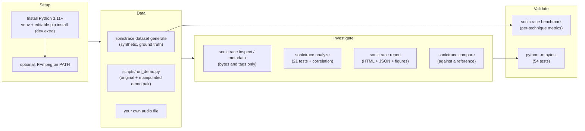
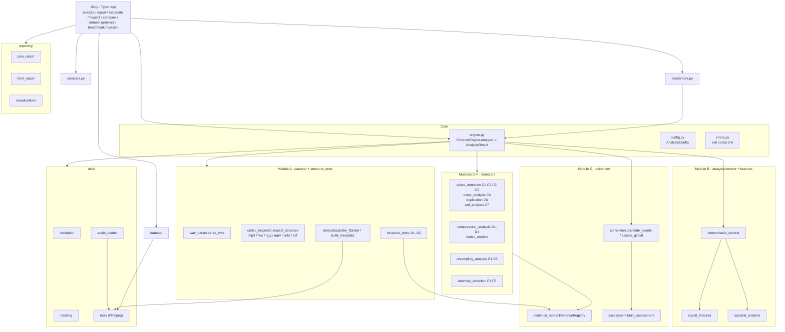
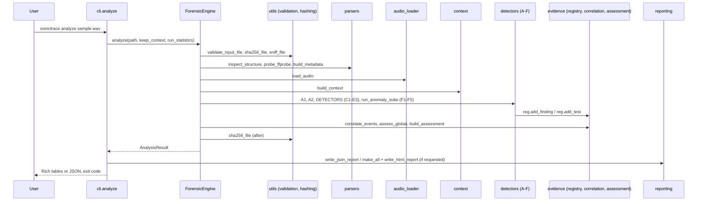
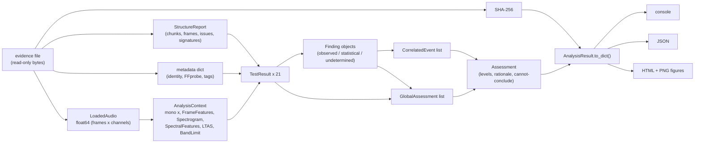
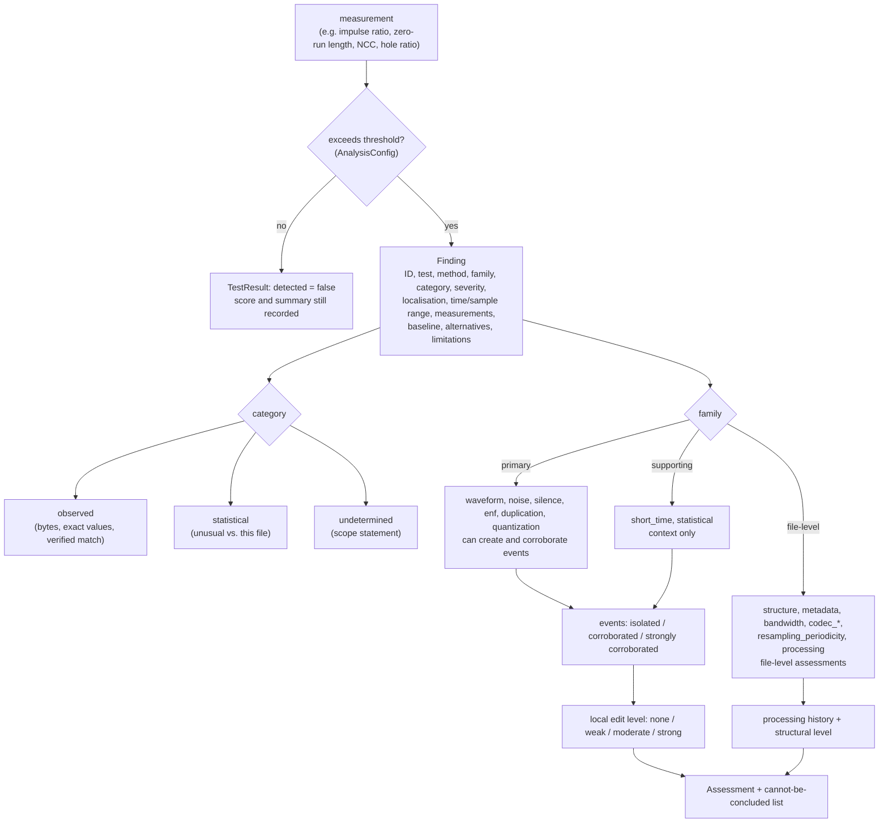
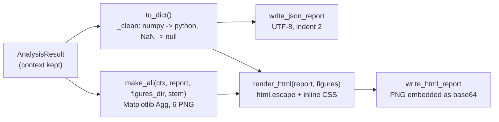
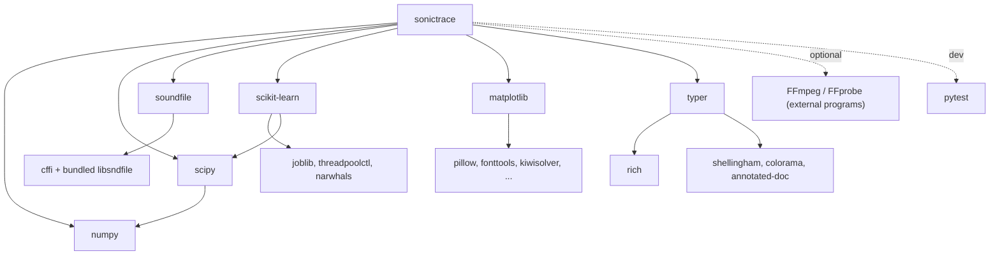

# SonicTrace - Project Workflow and Quick Reference

Workflows, diagrams and a command reference for SonicTrace 0.1.0 (methodology 1.2). All
diagrams reflect the functions that actually exist in `src/sonictrace/`.

---

## 1. Complete system workflow



Typical investigation of one file:

1. `sonictrace metadata FILE` and `sonictrace inspect FILE` - what does the container claim?
2. `sonictrace analyze FILE` - what do the 21 tests and the correlation engine find?
3. `sonictrace report FILE` - archive the full evidence record (HTML + JSON + figures).
4. If a trusted original exists: `sonictrace compare ORIGINAL FILE`.
5. Read the "cannot be concluded" list before writing any conclusion.

## 2. Architecture diagram



## 3. Module interaction (who calls whom during `analyze`)



## 4. Data flow



## 5. CLI command reference

| Command | Arguments | Options | Output | Writes files? |
|---|---|---|---|---|
| `sonictrace analyze FILE` | audio file | `-f/--format text\|json` (default text), `--json-out PATH`, `--html-out PATH`, `--no-stats`, `--max-mib N`, `--max-duration S` | console summary or JSON on stdout | only with `--json-out` / `--html-out` (figures go to `<html name>_figures\`) |
| `sonictrace report FILE` | audio file | `-o/--out-dir DIR` (default `output\reports`), `--max-mib`, `--max-duration` | short summary + paths | `<stem>_report.html`, `<stem>_report.json`, `<stem>_report_figures\*.png` |
| `sonictrace metadata FILE` | audio file | `--json` | table or JSON (identity, technical, tags, software signatures, SHA-256) | no |
| `sonictrace inspect FILE` | audio file | `--json` | chunk table (WAV) or details JSON, structural issues | no |
| `sonictrace compare ORIGINAL MODIFIED` | reference, questioned | `-o/--out-dir DIR`, `--json` | alignment summary and findings | with `--out-dir`: `comparison.json`, `comparison.png` |
| `sonictrace dataset generate` | - | `-o/--out DIR` (default `datasets\sonictrace_v1`), `--seed` (1337), `--sources` (4), `--controls` (4), `--duration` (6.0), `--no-mp3` | progress bar, summary | WAV/MP3 files, `manifest.json`, `manifest.csv` |
| `sonictrace benchmark` | - | `-d/--dataset DIR`, `--split calibration\|evaluation\|all` (default evaluation), `-o/--out DIR` (default `output\benchmark`) | metrics tables | `benchmark_<split>.md`, `.json`, `_per_file.csv` |
| `sonictrace version` | - | - | versions table | no |
| global | - | `--debug` (before the command) | tracebacks for unexpected errors | - |

Equivalent entry point: `python -m sonictrace <command> ...`.

## 6. Inputs and outputs

**Inputs**

| Input | Accepted | Decoder | Notes |
|---|---|---|---|
| WAV / RF64 / BWF | yes | libsndfile | own RIFF parser checks every chunk |
| FLAC | yes | libsndfile | STREAMINFO MD5 recomputed |
| Ogg (Vorbis/Opus) | yes | libsndfile (FFmpeg fallback) | page CRC-32 checked (first 20 MiB) |
| AIFF/AIFC | yes | libsndfile | minimal COMM/FORM checks |
| MP3 | with FFmpeg | FFmpeg -> temp WAV | frame walker, LAME tag, D4 |
| AAC (ADTS), MP4/M4A | with FFmpeg | FFmpeg -> temp WAV | box tree / ADTS frame checks |
| anything else | no | - | exit 3 |

Format is detected from the first bytes (`sniff_file`), not from the extension; an
extension mismatch is itself reported (A2). Limits: 512 MiB, 600 s, 16 channels (CLI
options change the first two).

**Outputs**

| Output | Produced by | Content |
|---|---|---|
| Console summary | `analyze` (text) | panel (identity, SHA-256, integrity, audio), indicator levels, 21-row tests table, events table, medium/high observed evidence, processing history, cannot-be-concluded list |
| JSON report | `analyze --format json`, `--json-out`, `report` | complete machine-readable record (see README section 13) |
| HTML report | `--html-out`, `report` | 11 sections + appendix, 6 embedded figures |
| Figures | `--html-out`, `report` | `waveform`, `spectrogram`, `frequency`, `rms`, `noise_floor`, `timeline` PNGs |
| Comparison | `compare --out-dir` | `comparison.json`, `comparison.png` |
| Dataset | `dataset generate` | audio files + manifest (labels, edit times, transformation logs, hashes) |
| Benchmark | `benchmark` | Markdown tables, JSON metrics, per-file CSV |

## 7. Evidence generation process



Rules in one place:

* independent families are counted after removing `noise` when `silence` is present;
* 1 family = isolated, 2 = corroborated, >= 3 = strongly corroborated;
* level strong = strongly corroborated event or HIGH observed local finding; moderate =
  corroborated event or MEDIUM observed local finding; weak = isolated events only.

## 8. Report generation process



`report` keeps the analysis context in memory (`keep_context=True`) because the figures
need the signal arrays; plain `analyze` only keeps it when `--html-out` is given.

## 9. Dependency map



| Internal module | Depends on |
|---|---|
| `analysis/*` | numpy, scipy; `anomaly_detection` also scikit-learn |
| `parsers/*` | standard library (struct, hashlib), numpy + soundfile (FLAC MD5) |
| `utils/audio_loader` | soundfile, `utils/tools` (FFmpeg) |
| `reporting/visualizations` | matplotlib, numpy |
| `cli` | typer, rich |
| `dataset/*` | numpy, scipy, soundfile, `utils/tools` (FFmpeg for MP3 conditions) |

## 10. Troubleshooting quick reference

| Symptom | Cause | Fix |
|---|---|---|
| `sonictrace : The term 'sonictrace' is not recognized` | venv not active | `.\.venv\Scripts\Activate.ps1`, or `.\.venv\Scripts\sonictrace.exe` |
| `running scripts is disabled on this system` | PowerShell execution policy | `Set-ExecutionPolicy -Scope CurrentUser -ExecutionPolicy RemoteSigned` (your decision) or skip activation |
| `Error: Decoding this format requires FFmpeg ...` (exit 6) | MP3/AAC/M4A without FFmpeg | install FFmpeg, open a new terminal, `ffmpeg -version` |
| `ffmpeg not found` in `sonictrace version` after installing | PATH not refreshed | open a new terminal; check `where.exe ffmpeg` |
| `Error: Input file not found` (exit 2) | wrong path | check the path; quote paths with spaces |
| `Error: Input file is empty` / `libsndfile could not open the file` (exit 4) | empty or malformed file | `sonictrace inspect FILE` shows the structural problem |
| `Error: Unsupported or unrecognised format` (exit 3) | not an audio container | convert with FFmpeg, or check the file |
| `exceeds the configured limit` (exit 5) | file > 512 MiB or > 600 s | `--max-mib` / `--max-duration` |
| `No manifest.json in ...` (benchmark, exit 2) | dataset not generated | `sonictrace dataset generate` |
| `Unexpected internal error` (exit 1) | bug | re-run with `sonictrace --debug ...` and report the traceback |
| A test shows status `error` in the report | one detector failed; the others ran | the JSON `tests[].measurements.traceback` contains the reason |
| Numbers differ from the documentation | other methodology version, seed or library versions | `sonictrace version`; regenerate the dataset with seed 1337 |
| JSON file has odd encoding after `>` redirection | PowerShell redirection | use `--json-out` |

---

## 11. One-page quick reference

```text
SONICTRACE QUICK REFERENCE  (SonicTrace 0.1.0, methodology 1.2)
=====================================================================
SETUP (once)
  py -3.12 -m venv .venv ; .\.venv\Scripts\Activate.ps1
  python -m pip install -e ".[dev]"        no API keys, no network use
  optional: winget install --id Gyan.FFmpeg -e   (MP3/AAC/M4A input)
  sonictrace version                       check components

DAILY USE
  sonictrace analyze FILE                  21 tests + correlation (console)
  sonictrace analyze FILE -f json          JSON on stdout
  sonictrace analyze FILE --json-out r.json --html-out r.html
  sonictrace report FILE -o output\reports HTML + JSON + 6 figures
  sonictrace metadata FILE [--json]        identity, FFprobe, tags, software
  sonictrace inspect FILE [--json]         chunks / frames / blocks / pages
  sonictrace compare ORIGINAL QUESTIONED -o output\compare
  sonictrace --debug <command> ...         tracebacks for internal errors

DATA AND VALIDATION
  sonictrace dataset generate              140 files, seed 1337, ~11 s
  python scripts\run_demo.py               original + manipulated demo pair
  sonictrace benchmark --split evaluation  metrics (synthetic data only!)
  python -m pytest                         53 passed, 1 xfailed

READING RESULTS
  observed     = measured fact (bytes, exact zeros, NCC match, checksum)
  statistical  = unusual vs. this file only (never corroboration)
  events       = isolated (1 family) | corroborated (2) | strongly (>=3)
  local level  = none | weak | moderate | strong   (rules, NOT probabilities)
  always read  "Cannot be concluded" before writing a conclusion

TESTS
  A1 container  A2 declared-vs-decoded
  C1 LPC impulse  C2 energy* C3 spectral*  C4 noise floor  C5 digital silence
  C6 copy-move (NCC)  C7 mains-hum phase                 (* = context only)
  D1 band limit  D2 spectral holes  D3 bit depth/histogram comb  D4 codec low-pass
  E1 empty band (upsampling)  E2 periodicity (experimental)  E3 rate metadata
  F1 robust z  F2 Isolation Forest  F3 PELT  F4 KS  F5 delta-BIC   (context only)

EXIT CODES
  0 ok | 1 internal | 2 invalid input | 3 unsupported | 4 malformed/empty
  5 limit exceeded | 6 FFmpeg missing

COMMON INNOCENT EXPLANATIONS
  click/plosive -> C1   noise gate -> C5   loop/hum -> C6   MP3 -> D1/D2/E1
  normalisation -> D3 (whole file)   room/AGC change -> C4
=====================================================================
```
